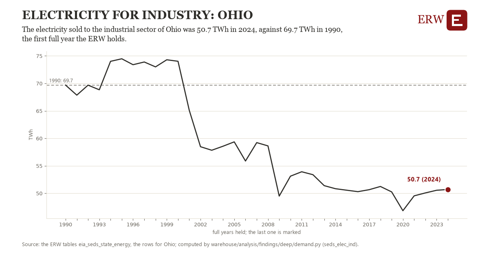

# Electricity for industry: Ohio

Draft `scan-deep-5631ee7e3585` of the findings hunt over the whole warehouse (chain 502), 2026-11-19. State: draft, not reviewed. Review at `/internal/findings`.

**The finding.** The electricity sold to the industrial sector of Ohio was 50.7 TWh in 2024, against 69.7 TWh in 1990, the first full year the ERW holds.

**The figure by full year** (TWh): 1990: 69.7, 1991: 67.9, 1992: 69.7, 1993: 68.8, 1994: 74.0, 1995: 74.5, 1996: 73.4, 1997: 73.9, 1998: 73.0, 1999: 74.3, 2000: 74.0, 2001: 65.1, 2002: 58.5, 2003: 57.8, 2004: 58.6, 2005: 59.4, 2006: 55.9, 2007: 59.2, 2008: 58.6, 2009: 49.5, 2010: 53.1, 2011: 53.9, 2012: 53.4, 2013: 51.4, 2014: 50.8, 2015: 50.6, 2016: 50.3, 2017: 50.7, 2018: 51.2, 2019: 50.2, 2020: 46.8, 2021: 49.5, 2022: 50.1, 2023: 50.5, 2024: 50.7.

**The tables and rows.** `eia_seds_state_energy`; the rows for Ohio, region key `sd_oh` (the card's `hunt.region`), years 1990 to 2024. The yearly values: `seds-elec-ind-sd-oh.csv`.

**Its strength.** The change is 15.55 typical yearly moves (a typical move is 1.2 TWh, 1.4826 times the median absolute change between full years). Holds in more than one year: 27 of the 34 full years after 1990 lie below 1990's value. Survives a change of window: from 1991 to 2024 the change is -17.2, from 1990 to 2023 it is -19.1. Sample large enough: 1990 holds 1 and 2024 holds 1 observations; the floor is 1. Half the change remains without the first year: from 1991 to 2024 the change is -17.2, 90.4 percent of the change from 1990. At least one typical yearly move: the change is 15.55 typical yearly moves (1.2 TWh a year, the median move between full years); the floor is 1.

**Its limits.** EIA's State Energy Data System, the latest release; the newest year is revised with each release; a state's consumption, wherever the energy was produced. TBtu over 3.412 gives TWh.

**Reproduce.** `python seds-elec-ind-sd-oh.reproduce.py <the table's CSV>` and `do seds-elec-ind-sd-oh.reproduce.do` (Stata) recompute the figures by year from the tables as the public downloads hold them; each names the expected values at its top.
