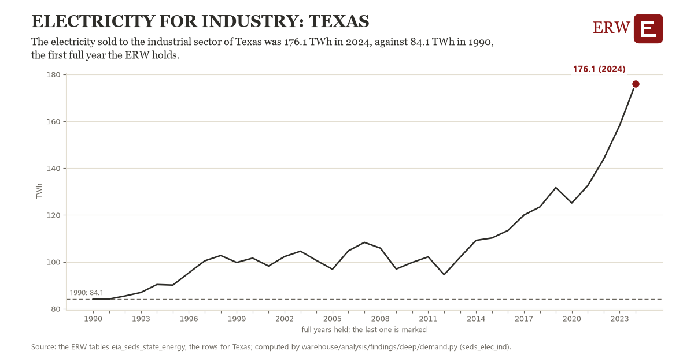

# Electricity for industry: Texas

Draft `scan-deep-4b23eb489e6a` of the findings hunt over the whole warehouse (chain 502), 2026-11-19. State: draft, not reviewed. Review at `/internal/findings`.

**The finding.** The electricity sold to the industrial sector of Texas was 176.1 TWh in 2024, against 84.1 TWh in 1990, the first full year the ERW holds.

**The figure by full year** (TWh): 1990: 84.1, 1991: 84.1, 1992: 85.4, 1993: 86.9, 1994: 90.3, 1995: 90.1, 1996: 95.3, 1997: 100.4, 1998: 102.7, 1999: 99.7, 2000: 101.6, 2001: 98.2, 2002: 102.3, 2003: 104.5, 2004: 100.6, 2005: 96.8, 2006: 104.7, 2007: 108.3, 2008: 105.9, 2009: 96.9, 2010: 99.8, 2011: 102.1, 2012: 94.5, 2013: 102.0, 2014: 109.2, 2015: 110.2, 2016: 113.4, 2017: 120.0, 2018: 123.4, 2019: 131.7, 2020: 125.1, 2021: 132.5, 2022: 143.9, 2023: 158.2, 2024: 176.1.

**The tables and rows.** `eia_seds_state_energy`; the rows for Texas, region key `sd_tx` (the card's `hunt.region`), years 1990 to 2024. The yearly values: `seds-elec-ind-sd-tx.csv`.

**Its strength.** The change is 16.88 typical yearly moves (a typical move is 5.5 TWh, 1.4826 times the median absolute change between full years). Holds in more than one year: 34 of the 34 full years after 1990 lie above 1990's value. Survives a change of window: from 1991 to 2024 the change is 92.0, from 1990 to 2023 it is 74.2. Sample large enough: 1990 holds 1 and 2024 holds 1 observations; the floor is 1. Half the change remains without the first year: from 1991 to 2024 the change is 92.0, 100.0 percent of the change from 1990. At least one typical yearly move: the change is 16.88 typical yearly moves (5.5 TWh a year, the median move between full years); the floor is 1.

**Its limits.** EIA's State Energy Data System, the latest release; the newest year is revised with each release; a state's consumption, wherever the energy was produced. TBtu over 3.412 gives TWh.

**Reproduce.** `python seds-elec-ind-sd-tx.reproduce.py <the table's CSV>` and `do seds-elec-ind-sd-tx.reproduce.do` (Stata) recompute the figures by year from the tables as the public downloads hold them; each names the expected values at its top.
