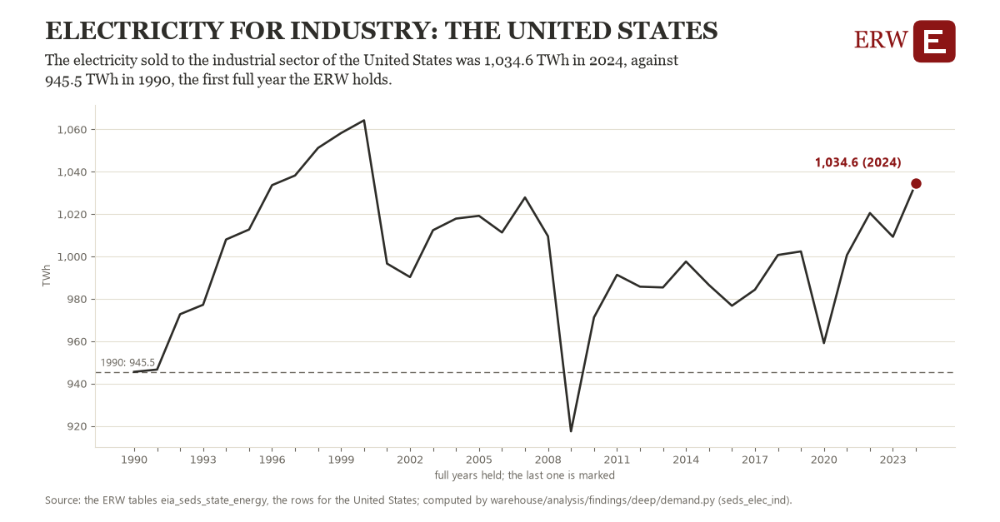

# Electricity for industry: the United States

Draft `scan-deep-0d6a432f0ee2` of the findings hunt over the whole warehouse (chain 502), 2026-11-19. State: draft, not reviewed. Review at `/internal/findings`.

**The finding.** The electricity sold to the industrial sector of the United States was 1,034.6 TWh in 2024, against 945.5 TWh in 1990, the first full year the ERW holds.

**The figure by full year** (TWh): 1990: 945.5, 1991: 946.6, 1992: 972.7, 1993: 977.2, 1994: 1,008.0, 1995: 1,012.7, 1996: 1,033.6, 1997: 1,038.2, 1998: 1,051.2, 1999: 1,058.2, 2000: 1,064.2, 2001: 996.6, 2002: 990.2, 2003: 1,012.4, 2004: 1,017.8, 2005: 1,019.2, 2006: 1,011.3, 2007: 1,027.8, 2008: 1,009.5, 2009: 917.4, 2010: 971.2, 2011: 991.3, 2012: 985.7, 2013: 985.4, 2014: 997.6, 2015: 986.5, 2016: 976.7, 2017: 984.3, 2018: 1,000.7, 2019: 1,002.4, 2020: 959.1, 2021: 1,000.6, 2022: 1,020.5, 2023: 1,009.3, 2024: 1,034.6.

**The tables and rows.** `eia_seds_state_energy`; the rows for the United States, region key `sd_us` (the card's `hunt.region`), years 1990 to 2024. The yearly values: `seds-elec-ind-sd-us.csv`.

**Its strength.** The change is 5.13 typical yearly moves (a typical move is 17.4 TWh, 1.4826 times the median absolute change between full years). Holds in more than one year: 33 of the 34 full years after 1990 lie above 1990's value. Survives a change of window: from 1991 to 2024 the change is 88.0, from 1990 to 2023 it is 63.7. Sample large enough: 1990 holds 1 and 2024 holds 1 observations; the floor is 1. Half the change remains without the first year: from 1991 to 2024 the change is 88.0, 98.8 percent of the change from 1990. At least one typical yearly move: the change is 5.13 typical yearly moves (17.4 TWh a year, the median move between full years); the floor is 1.

**Its limits.** EIA's State Energy Data System, the latest release; the newest year is revised with each release; a state's consumption, wherever the energy was produced. TBtu over 3.412 gives TWh.

**Reproduce.** `python seds-elec-ind-sd-us.reproduce.py <the table's CSV>` and `do seds-elec-ind-sd-us.reproduce.do` (Stata) recompute the figures by year from the tables as the public downloads hold them; each names the expected values at its top.
