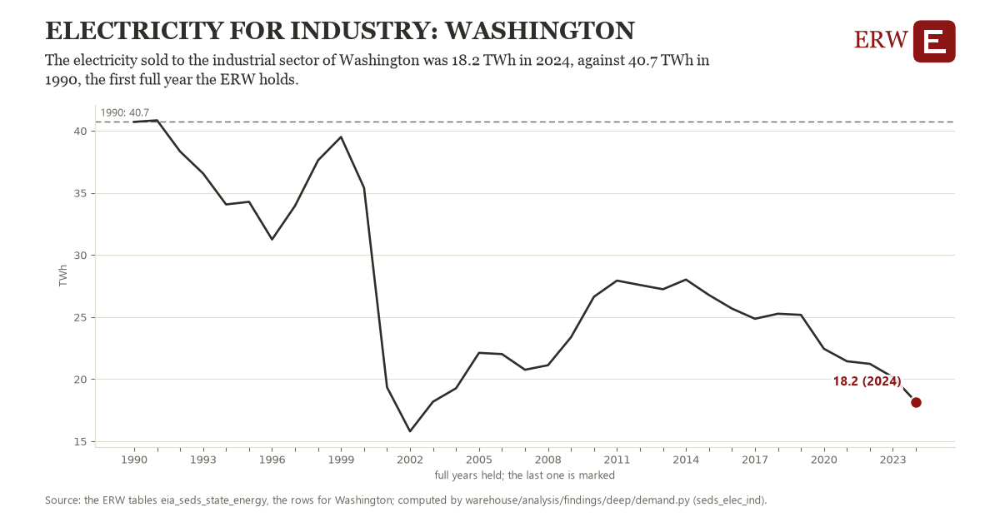

# Electricity for industry: Washington

Draft `scan-deep-e1e9c3188f87` of the findings hunt over the whole warehouse (chain 502), 2026-11-19. State: draft, not reviewed. Review at `/internal/findings`.

**The finding.** The electricity sold to the industrial sector of Washington was 18.2 TWh in 2024, against 40.7 TWh in 1990, the first full year the ERW holds.

**The figure by full year** (TWh): 1990: 40.7, 1991: 40.8, 1992: 38.3, 1993: 36.6, 1994: 34.1, 1995: 34.3, 1996: 31.2, 1997: 34.0, 1998: 37.6, 1999: 39.5, 2000: 35.4, 2001: 19.3, 2002: 15.8, 2003: 18.2, 2004: 19.3, 2005: 22.1, 2006: 22.0, 2007: 20.8, 2008: 21.1, 2009: 23.4, 2010: 26.6, 2011: 27.9, 2012: 27.6, 2013: 27.2, 2014: 28.0, 2015: 26.8, 2016: 25.7, 2017: 24.9, 2018: 25.3, 2019: 25.2, 2020: 22.4, 2021: 21.4, 2022: 21.2, 2023: 20.2, 2024: 18.2.

**The tables and rows.** `eia_seds_state_energy`; the rows for Washington, region key `sd_wa` (the card's `hunt.region`), years 1990 to 2024. The yearly values: `seds-elec-ind-sd-wa.csv`.

**Its strength.** The change is 11.88 typical yearly moves (a typical move is 1.9 TWh, 1.4826 times the median absolute change between full years). Holds in more than one year: 33 of the 34 full years after 1990 lie below 1990's value. Survives a change of window: from 1991 to 2024 the change is -22.7, from 1990 to 2023 it is -20.6. Sample large enough: 1990 holds 1 and 2024 holds 1 observations; the floor is 1. Half the change remains without the first year: from 1991 to 2024 the change is -22.7, 100.6 percent of the change from 1990. At least one typical yearly move: the change is 11.88 typical yearly moves (1.9 TWh a year, the median move between full years); the floor is 1.

**Its limits.** EIA's State Energy Data System, the latest release; the newest year is revised with each release; a state's consumption, wherever the energy was produced. TBtu over 3.412 gives TWh.

**Reproduce.** `python seds-elec-ind-sd-wa.reproduce.py <the table's CSV>` and `do seds-elec-ind-sd-wa.reproduce.do` (Stata) recompute the figures by year from the tables as the public downloads hold them; each names the expected values at its top.
