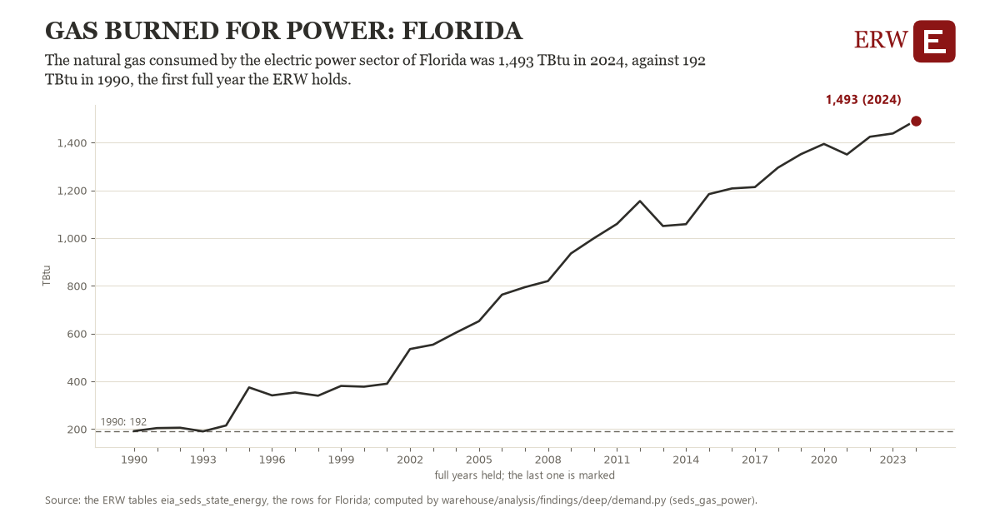

# Gas burned for power: Florida

Draft `scan-deep-7149f4e07987` of the findings hunt over the whole warehouse (chain 502), 2026-11-19. State: draft, not reviewed. Review at `/internal/findings`.

**The finding.** The natural gas consumed by the electric power sector of Florida was 1,493 TBtu in 2024, against 192 TBtu in 1990, the first full year the ERW holds.

**The figure by full year** (TBtu): 1990: 192, 1991: 204, 1992: 206, 1993: 190, 1994: 215, 1995: 374, 1996: 341, 1997: 353, 1998: 340, 1999: 381, 2000: 378, 2001: 390, 2002: 535, 2003: 553, 2004: 604, 2005: 652, 2006: 763, 2007: 794, 2008: 820, 2009: 936, 2010: 999, 2011: 1,059, 2012: 1,155, 2013: 1,051, 2014: 1,058, 2015: 1,184, 2016: 1,208, 2017: 1,214, 2018: 1,295, 2019: 1,351, 2020: 1,394, 2021: 1,350, 2022: 1,424, 2023: 1,438, 2024: 1,493.

**The tables and rows.** `eia_seds_state_energy`; the rows for Florida, region key `sd_fl` (the card's `hunt.region`), years 1990 to 2024. The yearly values: `seds-gas-power-sd-fl.csv`.

**Its strength.** The change is 20.93 typical yearly moves (a typical move is 62 TBtu, 1.4826 times the median absolute change between full years). Holds in more than one year: 33 of the 34 full years after 1990 lie above 1990's value. Survives a change of window: from 1991 to 2024 the change is 1,289, from 1990 to 2023 it is 1,247. Sample large enough: 1990 holds 1 and 2024 holds 1 observations; the floor is 1. Half the change remains without the first year: from 1991 to 2024 the change is 1,289, 99.0 percent of the change from 1990. At least one typical yearly move: the change is 20.93 typical yearly moves (62 TBtu a year, the median move between full years); the floor is 1.

**Its limits.** EIA's State Energy Data System, the latest release; the newest year is revised with each release; a state's consumption, wherever the energy was produced.

**Reproduce.** `python seds-gas-power-sd-fl.reproduce.py <the table's CSV>` and `do seds-gas-power-sd-fl.reproduce.do` (Stata) recompute the figures by year from the tables as the public downloads hold them; each names the expected values at its top.
