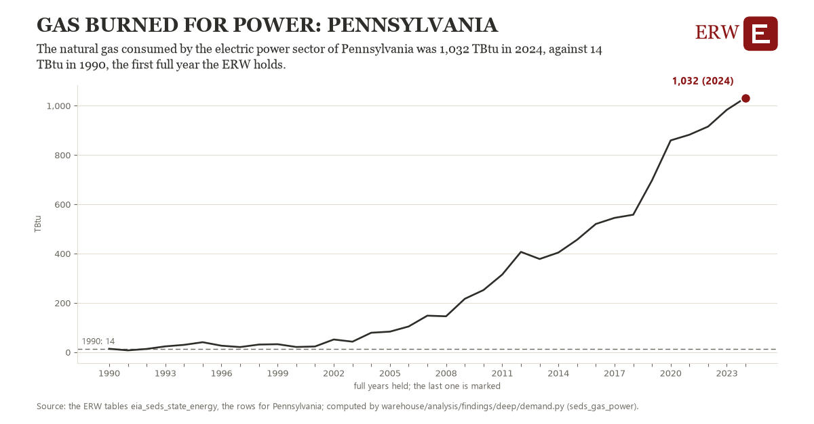

# Gas burned for power: Pennsylvania

Draft `scan-deep-a590d871ffdb` of the findings hunt over the whole warehouse (chain 502), 2026-11-19. State: draft, not reviewed. Review at `/internal/findings`.

**The finding.** The natural gas consumed by the electric power sector of Pennsylvania was 1,032 TBtu in 2024, against 14 TBtu in 1990, the first full year the ERW holds.

**The figure by full year** (TBtu): 1990: 14, 1991: 8, 1992: 13, 1993: 24, 1994: 30, 1995: 41, 1996: 26, 1997: 21, 1998: 31, 1999: 32, 2000: 21, 2001: 23, 2002: 52, 2003: 43, 2004: 79, 2005: 84, 2006: 104, 2007: 148, 2008: 146, 2009: 217, 2010: 252, 2011: 315, 2012: 407, 2013: 378, 2014: 404, 2015: 456, 2016: 520, 2017: 545, 2018: 558, 2019: 697, 2020: 859, 2021: 882, 2022: 915, 2023: 983, 2024: 1,032.

**The tables and rows.** `eia_seds_state_energy`; the rows for Pennsylvania, region key `sd_pa` (the card's `hunt.region`), years 1990 to 2024. The yearly values: `seds-gas-power-sd-pa.csv`.

**Its strength.** The change is 28.74 typical yearly moves (a typical move is 35 TBtu, 1.4826 times the median absolute change between full years). Holds in more than one year: 32 of the 34 full years after 1990 lie above 1990's value. Survives a change of window: from 1991 to 2024 the change is 1,025, from 1990 to 2023 it is 969. Sample large enough: 1990 holds 1 and 2024 holds 1 observations; the floor is 1. Half the change remains without the first year: from 1991 to 2024 the change is 1,025, 100.6 percent of the change from 1990. At least one typical yearly move: the change is 28.74 typical yearly moves (35 TBtu a year, the median move between full years); the floor is 1.

**Its limits.** EIA's State Energy Data System, the latest release; the newest year is revised with each release; a state's consumption, wherever the energy was produced.

**Reproduce.** `python seds-gas-power-sd-pa.reproduce.py <the table's CSV>` and `do seds-gas-power-sd-pa.reproduce.do` (Stata) recompute the figures by year from the tables as the public downloads hold them; each names the expected values at its top.
