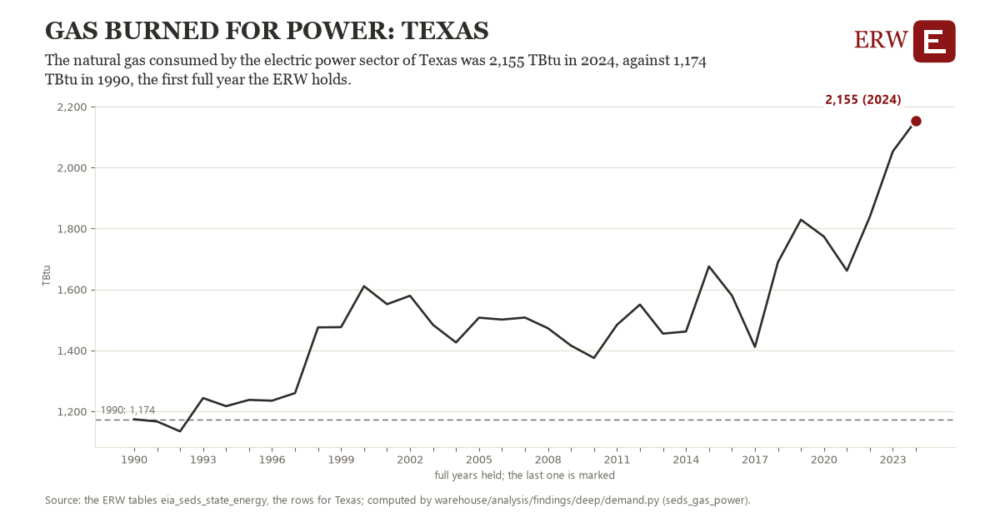

# Gas burned for power: Texas

Draft `scan-deep-25a9da72a987` of the findings hunt over the whole warehouse (chain 502), 2026-11-19. State: draft, not reviewed. Review at `/internal/findings`.

**The finding.** The natural gas consumed by the electric power sector of Texas was 2,155 TBtu in 2024, against 1,174 TBtu in 1990, the first full year the ERW holds.

**The figure by full year** (TBtu): 1990: 1,174, 1991: 1,167, 1992: 1,134, 1993: 1,244, 1994: 1,217, 1995: 1,238, 1996: 1,235, 1997: 1,260, 1998: 1,476, 1999: 1,476, 2000: 1,611, 2001: 1,552, 2002: 1,579, 2003: 1,484, 2004: 1,426, 2005: 1,507, 2006: 1,501, 2007: 1,508, 2008: 1,473, 2009: 1,416, 2010: 1,375, 2011: 1,484, 2012: 1,550, 2013: 1,455, 2014: 1,462, 2015: 1,676, 2016: 1,580, 2017: 1,412, 2018: 1,689, 2019: 1,829, 2020: 1,773, 2021: 1,662, 2022: 1,839, 2023: 2,053, 2024: 2,155.

**The tables and rows.** `eia_seds_state_energy`; the rows for Texas, region key `sd_tx` (the card's `hunt.region`), years 1990 to 2024. The yearly values: `seds-gas-power-sd-tx.csv`.

**Its strength.** The change is 10.54 typical yearly moves (a typical move is 93 TBtu, 1.4826 times the median absolute change between full years). Holds in more than one year: 32 of the 34 full years after 1990 lie above 1990's value. Survives a change of window: from 1991 to 2024 the change is 988, from 1990 to 2023 it is 879. Sample large enough: 1990 holds 1 and 2024 holds 1 observations; the floor is 1. Half the change remains without the first year: from 1991 to 2024 the change is 988, 100.7 percent of the change from 1990. At least one typical yearly move: the change is 10.54 typical yearly moves (93 TBtu a year, the median move between full years); the floor is 1.

**Its limits.** EIA's State Energy Data System, the latest release; the newest year is revised with each release; a state's consumption, wherever the energy was produced.

**Reproduce.** `python seds-gas-power-sd-tx.reproduce.py <the table's CSV>` and `do seds-gas-power-sd-tx.reproduce.do` (Stata) recompute the figures by year from the tables as the public downloads hold them; each names the expected values at its top.
