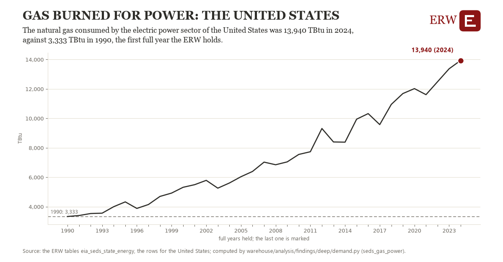

# Gas burned for power: the United States

Draft `scan-deep-c2618145ef19` of the findings hunt over the whole warehouse (chain 502), 2026-11-19. State: draft, not reviewed. Review at `/internal/findings`.

**The finding.** The natural gas consumed by the electric power sector of the United States was 13,940 TBtu in 2024, against 3,333 TBtu in 1990, the first full year the ERW holds.

**The figure by full year** (TBtu): 1990: 3,333, 1991: 3,399, 1992: 3,535, 1993: 3,559, 1994: 4,000, 1995: 4,327, 1996: 3,882, 1997: 4,147, 1998: 4,698, 1999: 4,924, 2000: 5,318, 2001: 5,496, 2002: 5,789, 2003: 5,259, 2004: 5,609, 2005: 6,036, 2006: 6,394, 2007: 7,028, 2008: 6,849, 2009: 7,044, 2010: 7,550, 2011: 7,734, 2012: 9,313, 2013: 8,398, 2014: 8,385, 2015: 9,945, 2016: 10,325, 2017: 9,578, 2018: 10,952, 2019: 11,687, 2020: 12,023, 2021: 11,612, 2022: 12,492, 2023: 13,372, 2024: 13,940.

**The tables and rows.** `eia_seds_state_energy`; the rows for the United States, region key `sd_us` (the card's `hunt.region`), years 1990 to 2024. The yearly values: `seds-gas-power-sd-us.csv`.

**Its strength.** The change is 17.77 typical yearly moves (a typical move is 597 TBtu, 1.4826 times the median absolute change between full years). Holds in more than one year: 34 of the 34 full years after 1990 lie above 1990's value. Survives a change of window: from 1991 to 2024 the change is 10,541, from 1990 to 2023 it is 10,039. Sample large enough: 1990 holds 1 and 2024 holds 1 observations; the floor is 1. Half the change remains without the first year: from 1991 to 2024 the change is 10,541, 99.4 percent of the change from 1990. At least one typical yearly move: the change is 17.77 typical yearly moves (597 TBtu a year, the median move between full years); the floor is 1.

**Its limits.** EIA's State Energy Data System, the latest release; the newest year is revised with each release; a state's consumption, wherever the energy was produced.

**Reproduce.** `python seds-gas-power-sd-us.reproduce.py <the table's CSV>` and `do seds-gas-power-sd-us.reproduce.do` (Stata) recompute the figures by year from the tables as the public downloads hold them; each names the expected values at its top.
