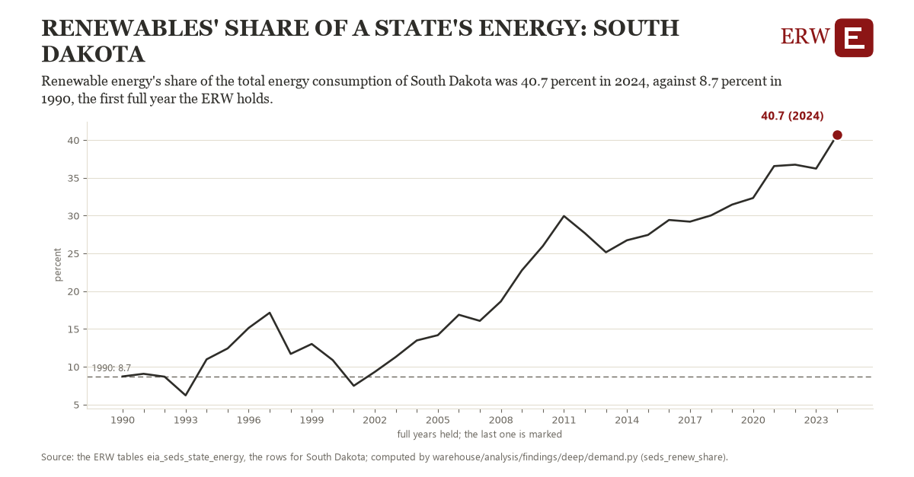

# Renewables' share of a state's energy: South Dakota

Draft `scan-deep-fdffa4fe6232` of the findings hunt over the whole warehouse (chain 502), 2026-11-19. State: draft, not reviewed. Review at `/internal/findings`.

**The finding.** Renewable energy's share of the total energy consumption of South Dakota was 40.7 percent in 2024, against 8.7 percent in 1990, the first full year the ERW holds.

**The figure by full year** (percent): 1990: 8.7, 1991: 9.1, 1992: 8.7, 1993: 6.2, 1994: 11.0, 1995: 12.4, 1996: 15.1, 1997: 17.1, 1998: 11.7, 1999: 13.0, 2000: 10.9, 2001: 7.5, 2002: 9.3, 2003: 11.3, 2004: 13.5, 2005: 14.2, 2006: 16.9, 2007: 16.1, 2008: 18.6, 2009: 22.8, 2010: 26.0, 2011: 30.0, 2012: 27.7, 2013: 25.2, 2014: 26.7, 2015: 27.4, 2016: 29.4, 2017: 29.2, 2018: 30.0, 2019: 31.5, 2020: 32.3, 2021: 36.6, 2022: 36.7, 2023: 36.2, 2024: 40.7.

**The tables and rows.** `eia_seds_state_energy`; the rows for South Dakota, region key `sd_sd` (the card's `hunt.region`), years 1990 to 2024. The yearly values: `seds-renew-share-sd-sd.csv`.

**Its strength.** The change is 10.80 typical yearly moves (a typical move is 3.0 percent, 1.4826 times the median absolute change between full years). Holds in more than one year: 31 of the 34 full years after 1990 lie above 1990's value. Survives a change of window: from 1991 to 2024 the change is 31.6, from 1990 to 2023 it is 27.5. Sample large enough: 1990 holds 1 and 2024 holds 1 observations; the floor is 1. Half the change remains without the first year: from 1991 to 2024 the change is 31.6, 98.9 percent of the change from 1990. At least one typical yearly move: the change is 10.80 typical yearly moves (3.0 percent a year, the median move between full years); the floor is 1.

**Its limits.** EIA's State Energy Data System, the latest release; the newest year is revised with each release; a state's consumption, wherever the energy was produced. Renewables as SEDS counts them, wood and biofuels included.

**Reproduce.** `python seds-renew-share-sd-sd.reproduce.py <the table's CSV>` and `do seds-renew-share-sd-sd.reproduce.do` (Stata) recompute the figures by year from the tables as the public downloads hold them; each names the expected values at its top.
