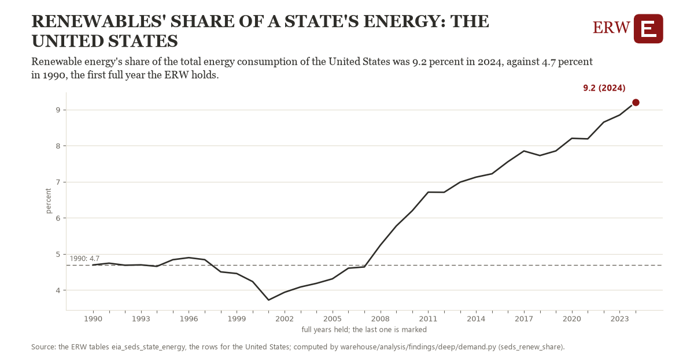

# Renewables' share of a state's energy: the United States

Draft `scan-deep-c92ac6cd623b` of the findings hunt over the whole warehouse (chain 502), 2026-11-19. State: draft, not reviewed. Review at `/internal/findings`.

**The finding.** Renewable energy's share of the total energy consumption of the United States was 9.2 percent in 2024, against 4.7 percent in 1990, the first full year the ERW holds.

**The figure by full year** (percent): 1990: 4.7, 1991: 4.7, 1992: 4.7, 1993: 4.7, 1994: 4.7, 1995: 4.8, 1996: 4.9, 1997: 4.8, 1998: 4.5, 1999: 4.5, 2000: 4.2, 2001: 3.7, 2002: 3.9, 2003: 4.1, 2004: 4.2, 2005: 4.3, 2006: 4.6, 2007: 4.6, 2008: 5.2, 2009: 5.8, 2010: 6.2, 2011: 6.7, 2012: 6.7, 2013: 7.0, 2014: 7.1, 2015: 7.2, 2016: 7.6, 2017: 7.9, 2018: 7.7, 2019: 7.9, 2020: 8.2, 2021: 8.2, 2022: 8.7, 2023: 8.8, 2024: 9.2.

**The tables and rows.** `eia_seds_state_energy`; the rows for the United States, region key `sd_us` (the card's `hunt.region`), years 1990 to 2024. The yearly values: `seds-renew-share-sd-us.csv`.

**Its strength.** The change is 18.35 typical yearly moves (a typical move is 0.2 percent, 1.4826 times the median absolute change between full years). Holds in more than one year: 22 of the 34 full years after 1990 lie above 1990's value. Survives a change of window: from 1991 to 2024 the change is 4.5, from 1990 to 2023 it is 4.2. Sample large enough: 1990 holds 1 and 2024 holds 1 observations; the floor is 1. Half the change remains without the first year: from 1991 to 2024 the change is 4.5, 98.9 percent of the change from 1990. At least one typical yearly move: the change is 18.35 typical yearly moves (0.2 percent a year, the median move between full years); the floor is 1.

**Its limits.** EIA's State Energy Data System, the latest release; the newest year is revised with each release; a state's consumption, wherever the energy was produced. Renewables as SEDS counts them, wood and biofuels included.

**Reproduce.** `python seds-renew-share-sd-us.reproduce.py <the table's CSV>` and `do seds-renew-share-sd-us.reproduce.do` (Stata) recompute the figures by year from the tables as the public downloads hold them; each names the expected values at its top.
