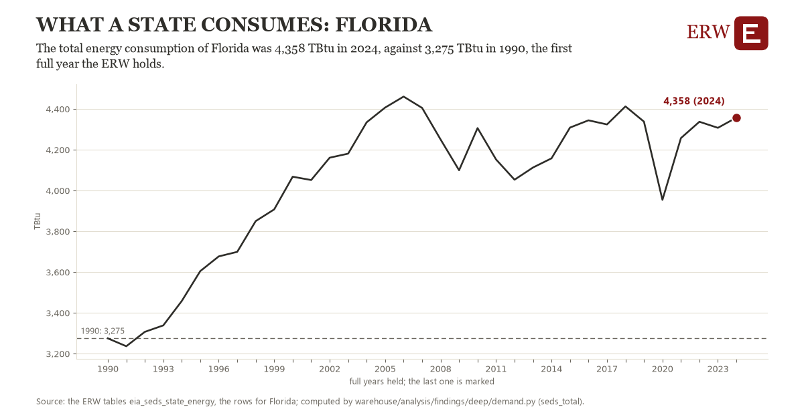

# What a state consumes: Florida

Draft `scan-deep-c1844f71112a` of the findings hunt over the whole warehouse (chain 502), 2026-11-19. State: draft, not reviewed. Review at `/internal/findings`.

**The finding.** The total energy consumption of Florida was 4,358 TBtu in 2024, against 3,275 TBtu in 1990, the first full year the ERW holds.

**The figure by full year** (TBtu): 1990: 3,275, 1991: 3,237, 1992: 3,307, 1993: 3,339, 1994: 3,458, 1995: 3,605, 1996: 3,677, 1997: 3,699, 1998: 3,850, 1999: 3,908, 2000: 4,068, 2001: 4,052, 2002: 4,161, 2003: 4,181, 2004: 4,335, 2005: 4,407, 2006: 4,461, 2007: 4,405, 2008: 4,250, 2009: 4,100, 2010: 4,306, 2011: 4,153, 2012: 4,053, 2013: 4,113, 2014: 4,158, 2015: 4,309, 2016: 4,344, 2017: 4,324, 2018: 4,413, 2019: 4,338, 2020: 3,954, 2021: 4,257, 2022: 4,337, 2023: 4,308, 2024: 4,358.

**The tables and rows.** `eia_seds_state_energy`; the rows for Florida, region key `sd_fl` (the card's `hunt.region`), years 1990 to 2024. The yearly values: `seds-total-sd-fl.csv`.

**Its strength.** The change is 9.94 typical yearly moves (a typical move is 109 TBtu, 1.4826 times the median absolute change between full years). Holds in more than one year: 33 of the 34 full years after 1990 lie above 1990's value. Survives a change of window: from 1991 to 2024 the change is 1,121, from 1990 to 2023 it is 1,032. Sample large enough: 1990 holds 1 and 2024 holds 1 observations; the floor is 1. Half the change remains without the first year: from 1991 to 2024 the change is 1,121, 103.6 percent of the change from 1990. At least one typical yearly move: the change is 9.94 typical yearly moves (109 TBtu a year, the median move between full years); the floor is 1.

**Its limits.** EIA's State Energy Data System, the latest release; the newest year is revised with each release; a state's consumption, wherever the energy was produced.

**Reproduce.** `python seds-total-sd-fl.reproduce.py <the table's CSV>` and `do seds-total-sd-fl.reproduce.do` (Stata) recompute the figures by year from the tables as the public downloads hold them; each names the expected values at its top.
