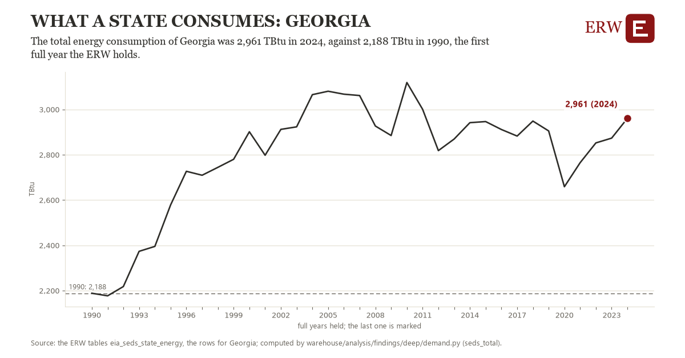

# What a state consumes: Georgia

Draft `scan-deep-c0b390bbb1b0` of the findings hunt over the whole warehouse (chain 502), 2026-11-19. State: draft, not reviewed. Review at `/internal/findings`.

**The finding.** The total energy consumption of Georgia was 2,961 TBtu in 2024, against 2,188 TBtu in 1990, the first full year the ERW holds.

**The figure by full year** (TBtu): 1990: 2,188, 1991: 2,177, 1992: 2,218, 1993: 2,373, 1994: 2,395, 1995: 2,578, 1996: 2,727, 1997: 2,709, 1998: 2,744, 1999: 2,780, 2000: 2,901, 2001: 2,798, 2002: 2,912, 2003: 2,923, 2004: 3,065, 2005: 3,080, 2006: 3,067, 2007: 3,061, 2008: 2,927, 2009: 2,885, 2010: 3,119, 2011: 3,000, 2012: 2,818, 2013: 2,869, 2014: 2,942, 2015: 2,946, 2016: 2,911, 2017: 2,882, 2018: 2,949, 2019: 2,905, 2020: 2,659, 2021: 2,765, 2022: 2,852, 2023: 2,873, 2024: 2,961.

**The tables and rows.** `eia_seds_state_energy`; the rows for Georgia, region key `sd_ga` (the card's `hunt.region`), years 1990 to 2024. The yearly values: `seds-total-sd-ga.csv`.

**Its strength.** The change is 8.88 typical yearly moves (a typical move is 87 TBtu, 1.4826 times the median absolute change between full years). Holds in more than one year: 33 of the 34 full years after 1990 lie above 1990's value. Survives a change of window: from 1991 to 2024 the change is 784, from 1990 to 2023 it is 685. Sample large enough: 1990 holds 1 and 2024 holds 1 observations; the floor is 1. Half the change remains without the first year: from 1991 to 2024 the change is 784, 101.5 percent of the change from 1990. At least one typical yearly move: the change is 8.88 typical yearly moves (87 TBtu a year, the median move between full years); the floor is 1.

**Its limits.** EIA's State Energy Data System, the latest release; the newest year is revised with each release; a state's consumption, wherever the energy was produced.

**Reproduce.** `python seds-total-sd-ga.reproduce.py <the table's CSV>` and `do seds-total-sd-ga.reproduce.do` (Stata) recompute the figures by year from the tables as the public downloads hold them; each names the expected values at its top.
