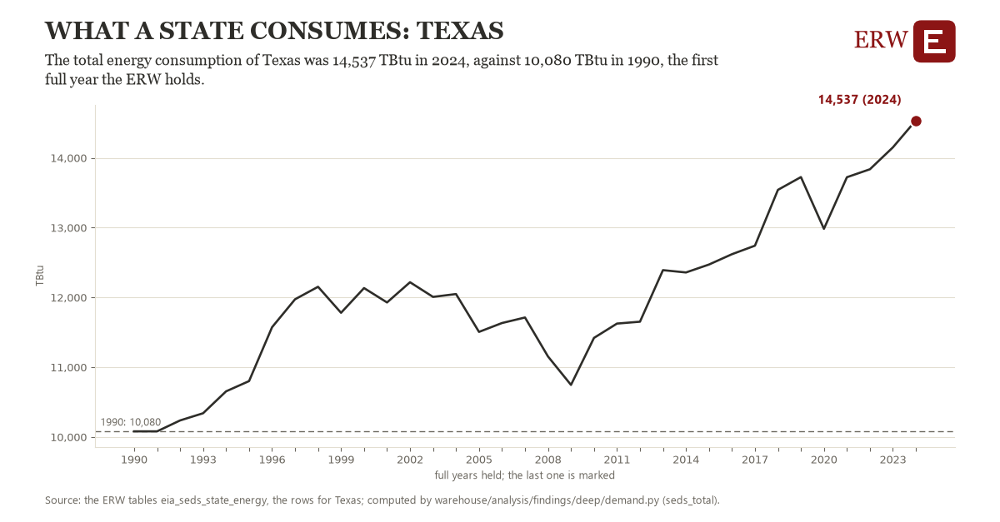

# What a state consumes: Texas

Draft `scan-deep-ee04ea02afb4` of the findings hunt over the whole warehouse (chain 502), 2026-11-19. State: draft, not reviewed. Review at `/internal/findings`.

**The finding.** The total energy consumption of Texas was 14,537 TBtu in 2024, against 10,080 TBtu in 1990, the first full year the ERW holds.

**The figure by full year** (TBtu): 1990: 10,080, 1991: 10,080, 1992: 10,236, 1993: 10,339, 1994: 10,653, 1995: 10,800, 1996: 11,572, 1997: 11,972, 1998: 12,152, 1999: 11,779, 2000: 12,133, 2001: 11,927, 2002: 12,217, 2003: 12,007, 2004: 12,048, 2005: 11,505, 2006: 11,632, 2007: 11,711, 2008: 11,153, 2009: 10,746, 2010: 11,419, 2011: 11,624, 2012: 11,651, 2013: 12,390, 2014: 12,357, 2015: 12,470, 2016: 12,618, 2017: 12,741, 2018: 13,541, 2019: 13,724, 2020: 12,982, 2021: 13,722, 2022: 13,836, 2023: 14,150, 2024: 14,537.

**The tables and rows.** `eia_seds_state_energy`; the rows for Texas, region key `sd_tx` (the card's `hunt.region`), years 1990 to 2024. The yearly values: `seds-total-sd-tx.csv`.

**Its strength.** The change is 14.45 typical yearly moves (a typical move is 308 TBtu, 1.4826 times the median absolute change between full years). Holds in more than one year: 34 of the 34 full years after 1990 lie above 1990's value. Survives a change of window: from 1991 to 2024 the change is 4,457, from 1990 to 2023 it is 4,070. Sample large enough: 1990 holds 1 and 2024 holds 1 observations; the floor is 1. Half the change remains without the first year: from 1991 to 2024 the change is 4,457, 100.0 percent of the change from 1990. At least one typical yearly move: the change is 14.45 typical yearly moves (308 TBtu a year, the median move between full years); the floor is 1.

**Its limits.** EIA's State Energy Data System, the latest release; the newest year is revised with each release; a state's consumption, wherever the energy was produced.

**Reproduce.** `python seds-total-sd-tx.reproduce.py <the table's CSV>` and `do seds-total-sd-tx.reproduce.do` (Stata) recompute the figures by year from the tables as the public downloads hold them; each names the expected values at its top.
