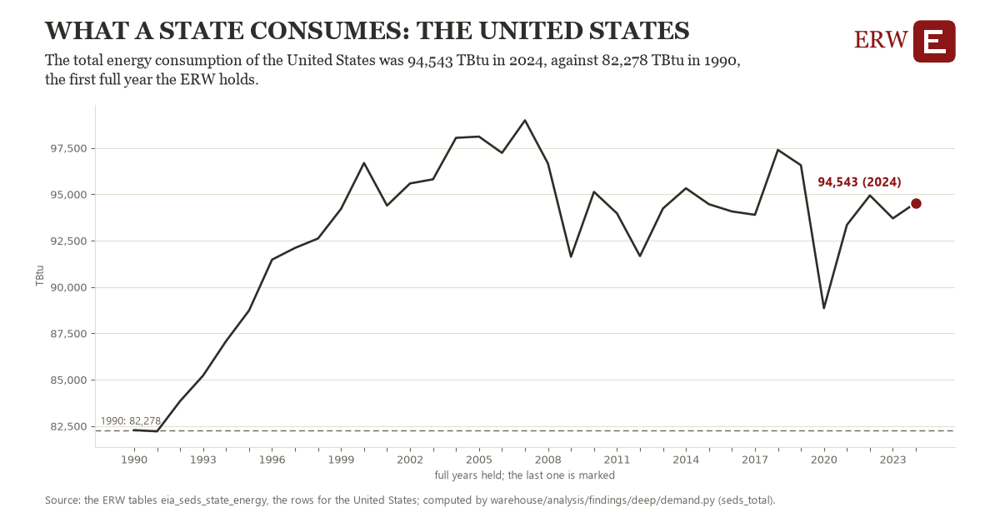

# What a state consumes: the United States

Draft `scan-deep-ec0579edc9b9` of the findings hunt over the whole warehouse (chain 502), 2026-11-19. State: draft, not reviewed. Review at `/internal/findings`.

**The finding.** The total energy consumption of the United States was 94,543 TBtu in 2024, against 82,278 TBtu in 1990, the first full year the ERW holds.

**The figure by full year** (TBtu): 1990: 82,278, 1991: 82,213, 1992: 83,843, 1993: 85,220, 1994: 87,080, 1995: 88,732, 1996: 91,474, 1997: 92,106, 1998: 92,615, 1999: 94,213, 2000: 96,686, 2001: 94,391, 2002: 95,582, 2003: 95,807, 2004: 98,045, 2005: 98,109, 2006: 97,231, 2007: 98,988, 2008: 96,658, 2009: 91,631, 2010: 95,129, 2011: 93,969, 2012: 91,664, 2013: 94,234, 2014: 95,322, 2015: 94,463, 2016: 94,073, 2017: 93,893, 2018: 97,392, 2019: 96,565, 2020: 88,857, 2021: 93,349, 2022: 94,937, 2023: 93,700, 2024: 94,543.

**The tables and rows.** `eia_seds_state_energy`; the rows for the United States, region key `sd_us` (the card's `hunt.region`), years 1990 to 2024. The yearly values: `seds-total-sd-us.csv`.

**Its strength.** The change is 5.19 typical yearly moves (a typical move is 2,362 TBtu, 1.4826 times the median absolute change between full years). Holds in more than one year: 33 of the 34 full years after 1990 lie above 1990's value. Survives a change of window: from 1991 to 2024 the change is 12,331, from 1990 to 2023 it is 11,422. Sample large enough: 1990 holds 1 and 2024 holds 1 observations; the floor is 1. Half the change remains without the first year: from 1991 to 2024 the change is 12,331, 100.5 percent of the change from 1990. At least one typical yearly move: the change is 5.19 typical yearly moves (2,362 TBtu a year, the median move between full years); the floor is 1.

**Its limits.** EIA's State Energy Data System, the latest release; the newest year is revised with each release; a state's consumption, wherever the energy was produced.

**Reproduce.** `python seds-total-sd-us.reproduce.py <the table's CSV>` and `do seds-total-sd-us.reproduce.do` (Stata) recompute the figures by year from the tables as the public downloads hold them; each names the expected values at its top.
