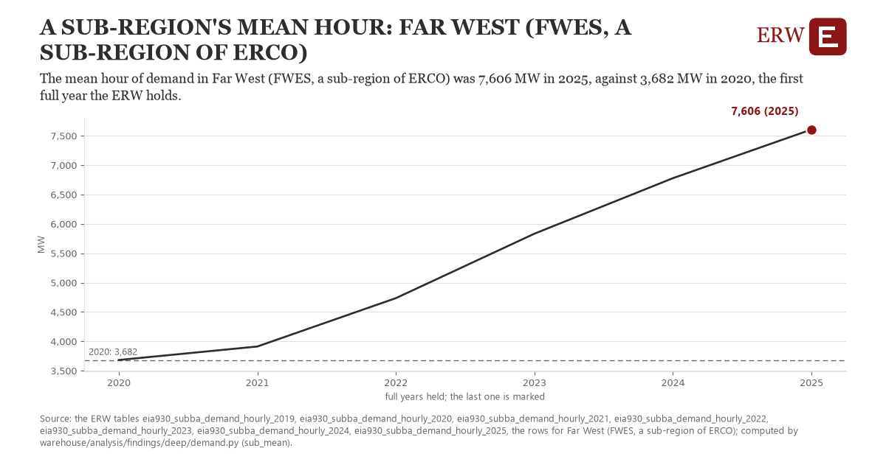

# A sub-region's mean hour: Far West (FWES, a sub-region of ERCO)

Draft `scan-deep-5d357242de6d` of the findings hunt over the whole warehouse (chain 164), 2026-11-06. State: draft, not reviewed. Review at `/internal/findings`.

**The finding.** The mean hour of demand in Far West (FWES, a sub-region of ERCO) was 7,606 MW in 2025, against 3,682 MW in 2020, the first full year the ERW holds.

**The figure by full year** (MW): 2020: 3,682, 2021: 3,912, 2022: 4,735, 2023: 5,833, 2024: 6,778, 2025: 7,606.

**The tables and rows.** `eia930_subba_demand_hourly_2019`, `eia930_subba_demand_hourly_2020`, `eia930_subba_demand_hourly_2021`, `eia930_subba_demand_hourly_2022`, `eia930_subba_demand_hourly_2023`, `eia930_subba_demand_hourly_2024`, `eia930_subba_demand_hourly_2025`; the rows for Far West (FWES, a sub-region of ERCO), region key `ercot_sub_FWES` (the card's `hunt.region`), years 2020 to 2025. The yearly values: `sub-mean-ercot-sub-fwes.csv`.

**Its strength.** The change is 3.19 typical yearly moves (a typical move is 1,229 MW, 1.4826 times the median absolute change between full years). Holds in more than one year: 5 of the 5 full years after 2020 lie above 2020's value. Survives a change of window: from 2021 to 2025 the change is 3,695, from 2020 to 2024 it is 3,095. Sample large enough: 2020 holds 8,784 and 2025 holds 8,690 observations; the floor is 8,000. Half the change remains without the first year: from 2021 to 2025 the change is 3,695, 94.1 percent of the change from 2020. At least one typical yearly move: the change is 3.19 typical yearly moves (1,229 MW a year, the median move between full years); the floor is 1.

**Its limits.** Not adjusted for weather; EIA-930 sub-region data as reported, and a change of the sub-region's footprint changes its demand.

**Reproduce.** `python sub-mean-ercot-sub-fwes.reproduce.py <the table's CSV>` and `do sub-mean-ercot-sub-fwes.reproduce.do` (Stata) recompute the figures by year from the tables as the public downloads hold them; each names the expected values at its top.
