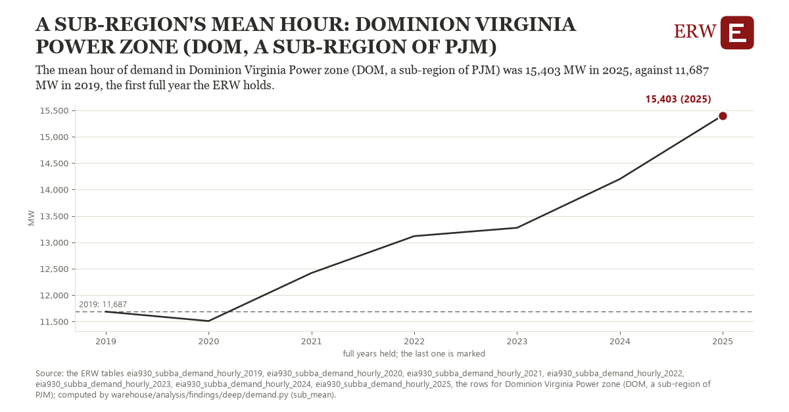

# A sub-region's mean hour: Dominion Virginia Power zone (DOM, a sub-region of PJM)

Draft `scan-deep-99a9fa233018` of the findings hunt over the whole warehouse (chain 164), 2026-11-06. State: draft, not reviewed. Review at `/internal/findings`.

**The finding.** The mean hour of demand in Dominion Virginia Power zone (DOM, a sub-region of PJM) was 15,403 MW in 2025, against 11,687 MW in 2019, the first full year the ERW holds.

**The figure by full year** (MW): 2019: 11,687, 2020: 11,510, 2021: 12,419, 2022: 13,118, 2023: 13,276, 2024: 14,199, 2025: 15,403.

**The tables and rows.** `eia930_subba_demand_hourly_2019`, `eia930_subba_demand_hourly_2020`, `eia930_subba_demand_hourly_2021`, `eia930_subba_demand_hourly_2022`, `eia930_subba_demand_hourly_2023`, `eia930_subba_demand_hourly_2024`, `eia930_subba_demand_hourly_2025`; the rows for Dominion Virginia Power zone (DOM, a sub-region of PJM), region key `pjm_sub_DOM` (the card's `hunt.region`), years 2019 to 2025. The yearly values: `sub-mean-pjm-sub-dom.csv`.

**Its strength.** The change is 3.12 typical yearly moves (a typical move is 1,192 MW, 1.4826 times the median absolute change between full years). Holds in more than one year: 5 of the 6 full years after 2019 lie above 2019's value. Survives a change of window: from 2020 to 2025 the change is 3,893, from 2019 to 2024 it is 2,512. Sample large enough: 2019 holds 8,735 and 2025 holds 8,729 observations; the floor is 8,000. Half the change remains without the first year: from 2020 to 2025 the change is 3,893, 104.8 percent of the change from 2019. At least one typical yearly move: the change is 3.12 typical yearly moves (1,192 MW a year, the median move between full years); the floor is 1.

**Its limits.** Not adjusted for weather; EIA-930 sub-region data as reported, and a change of the sub-region's footprint changes its demand.

**Reproduce.** `python sub-mean-pjm-sub-dom.reproduce.py <the table's CSV>` and `do sub-mean-pjm-sub-dom.reproduce.do` (Stata) recompute the figures by year from the tables as the public downloads hold them; each names the expected values at its top.
