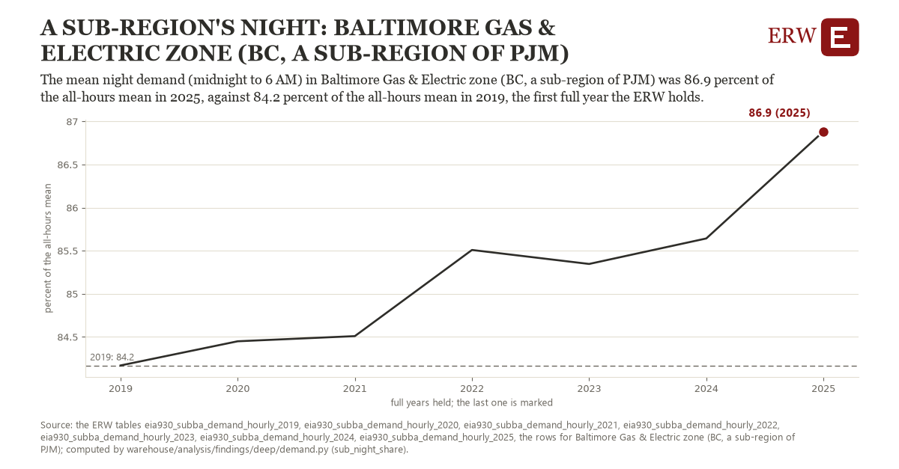

# A sub-region's night: Baltimore Gas & Electric zone (BC, a sub-region of PJM)

Draft `scan-deep-0f5a1fecd0f8` of the findings hunt over the whole warehouse (chain 164), 2026-11-06. State: draft, not reviewed. Review at `/internal/findings`.

**The finding.** The mean night demand (midnight to 6 AM) in Baltimore Gas & Electric zone (BC, a sub-region of PJM) was 86.9 percent of the all-hours mean in 2025, against 84.2 percent of the all-hours mean in 2019, the first full year the ERW holds.

**The figure by full year** (percent of the all-hours mean): 2019: 84.2, 2020: 84.4, 2021: 84.5, 2022: 85.5, 2023: 85.3, 2024: 85.6, 2025: 86.9.

**The tables and rows.** `eia930_subba_demand_hourly_2019`, `eia930_subba_demand_hourly_2020`, `eia930_subba_demand_hourly_2021`, `eia930_subba_demand_hourly_2022`, `eia930_subba_demand_hourly_2023`, `eia930_subba_demand_hourly_2024`, `eia930_subba_demand_hourly_2025`; the rows for Baltimore Gas & Electric zone (BC, a sub-region of PJM), region key `pjm_sub_BC` (the card's `hunt.region`), years 2019 to 2025. The yearly values: `sub-night-share-pjm-sub-bc.csv`.

**Its strength.** The change is 6.36 typical yearly moves (a typical move is 0.4 percent of the all-hours mean, 1.4826 times the median absolute change between full years). Holds in more than one year: 6 of the 6 full years after 2019 lie above 2019's value. Survives a change of window: from 2020 to 2025 the change is 2.4, from 2019 to 2024 it is 1.5. Sample large enough: 2019 holds 8,735 and 2025 holds 8,729 observations; the floor is 8,000. Half the change remains without the first year: from 2020 to 2025 the change is 2.4, 89.7 percent of the change from 2019. At least one typical yearly move: the change is 6.36 typical yearly moves (0.4 percent of the all-hours mean a year, the median move between full years); the floor is 1.

**Its limits.** A ratio of two means: demand that grows in every hour alike leaves it where it was, and demand that grows by day lowers it.

**Reproduce.** `python sub-night-share-pjm-sub-bc.reproduce.py <the table's CSV>` and `do sub-night-share-pjm-sub-bc.reproduce.do` (Stata) recompute the figures by year from the tables as the public downloads hold them; each names the expected values at its top.
