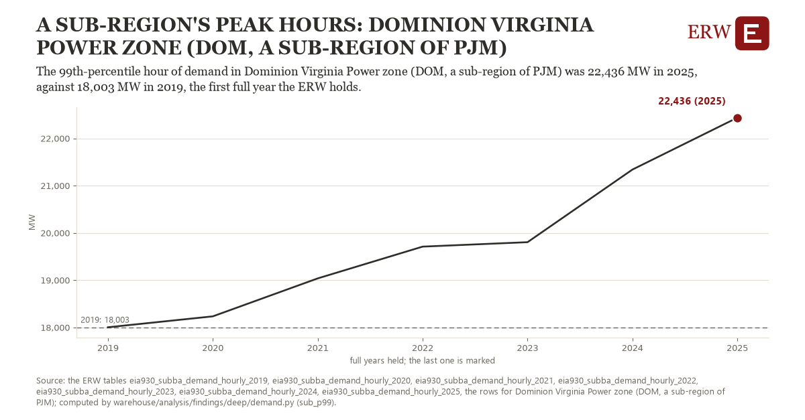

# A sub-region's peak hours: Dominion Virginia Power zone (DOM, a sub-region of PJM)

Draft `scan-deep-19bbb7ecebde` of the findings hunt over the whole warehouse (chain 164), 2026-11-06. State: draft, not reviewed. Review at `/internal/findings`.

**The finding.** The 99th-percentile hour of demand in Dominion Virginia Power zone (DOM, a sub-region of PJM) was 22,436 MW in 2025, against 18,003 MW in 2019, the first full year the ERW holds.

**The figure by full year** (MW): 2019: 18,003, 2020: 18,234, 2021: 19,037, 2022: 19,709, 2023: 19,803, 2024: 21,339, 2025: 22,436.

**The tables and rows.** `eia930_subba_demand_hourly_2019`, `eia930_subba_demand_hourly_2020`, `eia930_subba_demand_hourly_2021`, `eia930_subba_demand_hourly_2022`, `eia930_subba_demand_hourly_2023`, `eia930_subba_demand_hourly_2024`, `eia930_subba_demand_hourly_2025`; the rows for Dominion Virginia Power zone (DOM, a sub-region of PJM), region key `pjm_sub_DOM` (the card's `hunt.region`), years 2019 to 2025. The yearly values: `sub-p99-pjm-sub-dom.csv`.

**Its strength.** The change is 4.05 typical yearly moves (a typical move is 1,093 MW, 1.4826 times the median absolute change between full years). Holds in more than one year: 6 of the 6 full years after 2019 lie above 2019's value. Survives a change of window: from 2020 to 2025 the change is 4,202, from 2019 to 2024 it is 3,336. Sample large enough: 2019 holds 8,735 and 2025 holds 8,729 observations; the floor is 8,000. Half the change remains without the first year: from 2020 to 2025 the change is 4,202, 94.8 percent of the change from 2019. At least one typical yearly move: the change is 4.05 typical yearly moves (1,093 MW a year, the median move between full years); the floor is 1.

**Its limits.** EIA-930 sub-region data as the operator reported it; an hour over three times its year's median is dropped as a fault, and a change of the sub-region's footprint changes its demand.

**Reproduce.** `python sub-p99-pjm-sub-dom.reproduce.py <the table's CSV>` and `do sub-p99-pjm-sub-dom.reproduce.do` (Stata) recompute the figures by year from the tables as the public downloads hold them; each names the expected values at its top.
