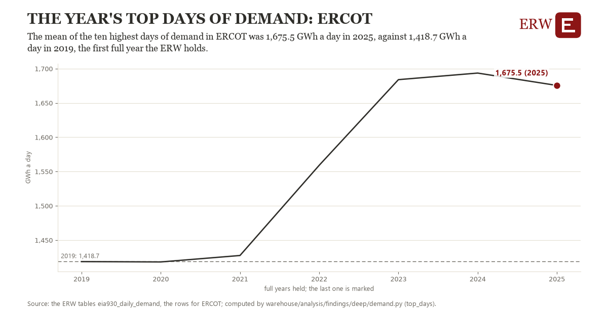

# The year's top days of demand: ERCOT

Draft `scan-deep-fd75816434cd` of the findings hunt over the whole warehouse (chain 164), 2026-11-06. State: draft, not reviewed. Review at `/internal/findings`.

**The finding.** The mean of the ten highest days of demand in ERCOT was 1,675.5 GWh a day in 2025, against 1,418.7 GWh a day in 2019, the first full year the ERW holds.

**The figure by full year** (GWh a day): 2019: 1,418.7, 2020: 1,418.2, 2021: 1,427.6, 2022: 1,559.1, 2023: 1,684.0, 2024: 1,693.5, 2025: 1,675.5.

**The tables and rows.** `eia930_daily_demand`; the rows for ERCOT, region key `ercot_ba` (the card's `hunt.region`), years 2019 to 2025. The yearly values: `top-days-ercot-ba.csv`.

**Its strength.** The change is 12.54 typical yearly moves (a typical move is 20.5 GWh a day, 1.4826 times the median absolute change between full years). Holds in more than one year: 5 of the 6 full years after 2019 lie above 2019's value. Survives a change of window: from 2020 to 2025 the change is 257.3, from 2019 to 2024 it is 274.9. Sample large enough: 2019 holds 365 and 2025 holds 365 observations; the floor is 330. Half the change remains without the first year: from 2020 to 2025 the change is 257.3, 100.2 percent of the change from 2019. At least one typical yearly move: the change is 12.54 typical yearly moves (20.5 GWh a day a year, the median move between full years); the floor is 1.

**Its limits.** EIA-930 as the respondent reported it, by EIA's Eastern day; days of reporting faults are dropped by a rule, and a respondent that changed its footprint changes its demand.

**Reproduce.** `python top-days-ercot-ba.reproduce.py <the table's CSV>` and `do top-days-ercot-ba.reproduce.do` (Stata) recompute the figures by year from the tables as the public downloads hold them; each names the expected values at its top.
