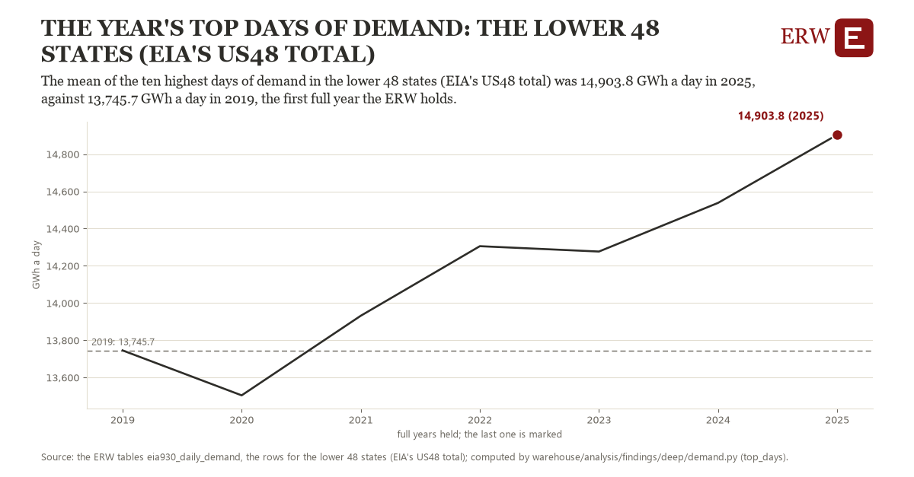

# The year's top days of demand: the lower 48 states (EIA's US48 total)

Draft `scan-deep-9c50aad59286` of the findings hunt over the whole warehouse (chain 164), 2026-11-06. State: draft, not reviewed. Review at `/internal/findings`.

**The finding.** The mean of the ten highest days of demand in the lower 48 states (EIA's US48 total) was 14,903.8 GWh a day in 2025, against 13,745.7 GWh a day in 2019, the first full year the ERW holds.

**The figure by full year** (GWh a day): 2019: 13,745.7, 2020: 13,504.2, 2021: 13,931.7, 2022: 14,305.6, 2023: 14,276.8, 2024: 14,538.1, 2025: 14,903.8.

**The tables and rows.** `eia930_daily_demand`; the rows for the lower 48 states (EIA's US48 total), region key `us48` (the card's `hunt.region`), years 2019 to 2025. The yearly values: `top-days-us48.csv`.

**Its strength.** The change is 2.49 typical yearly moves (a typical move is 464.8 GWh a day, 1.4826 times the median absolute change between full years). Holds in more than one year: 5 of the 6 full years after 2019 lie above 2019's value. Survives a change of window: from 2020 to 2025 the change is 1,399.7, from 2019 to 2024 it is 792.4. Sample large enough: 2019 holds 365 and 2025 holds 365 observations; the floor is 330. Half the change remains without the first year: from 2020 to 2025 the change is 1,399.7, 120.9 percent of the change from 2019. At least one typical yearly move: the change is 2.49 typical yearly moves (464.8 GWh a day a year, the median move between full years); the floor is 1.

**Its limits.** EIA-930 as the respondent reported it, by EIA's Eastern day; days of reporting faults are dropped by a rule, and a respondent that changed its footprint changes its demand.

**Reproduce.** `python top-days-us48.reproduce.py <the table's CSV>` and `do top-days-us48.reproduce.do` (Stata) recompute the figures by year from the tables as the public downloads hold them; each names the expected values at its top.
