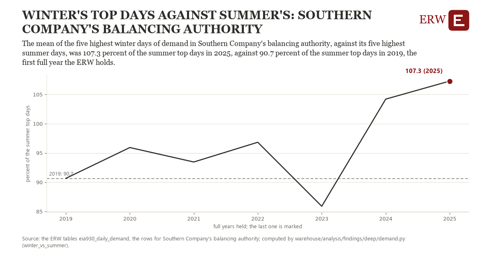

# Winter's top days against summer's: Southern Company's balancing authority

Draft `scan-deep-bc17ba25950a` of the findings hunt over the whole warehouse (chain 164), 2026-11-06. State: draft, not reviewed. Review at `/internal/findings`.

**The finding.** The mean of the five highest winter days of demand in Southern Company's balancing authority, against its five highest summer days, was 107.3 percent of the summer top days in 2025, against 90.7 percent of the summer top days in 2019, the first full year the ERW holds.

**The figure by full year** (percent of the summer top days): 2019: 90.7, 2020: 95.9, 2021: 93.4, 2022: 96.8, 2023: 85.9, 2024: 104.2, 2025: 107.3.

**The tables and rows.** `eia930_daily_demand`; the rows for Southern Company's balancing authority, region key `ba_soco` (the card's `hunt.region`), years 2019 to 2025. The yearly values: `winter-vs-summer-ba-soco.csv`.

**Its strength.** The change is 2.60 typical yearly moves (a typical move is 6.4 percent of the summer top days, 1.4826 times the median absolute change between full years). Holds in more than one year: 5 of the 6 full years after 2019 lie above 2019's value. Survives a change of window: from 2020 to 2025 the change is 11.4, from 2019 to 2024 it is 13.5. Sample large enough: 2019 holds 365 and 2025 holds 365 observations; the floor is 330. Half the change remains without the first year: from 2020 to 2025 the change is 11.4, 68.3 percent of the change from 2019. At least one typical yearly move: the change is 2.60 typical yearly moves (6.4 percent of the summer top days a year, the median move between full years); the floor is 1.

**Its limits.** Five days a season: one cold spell or one heat wave can carry a year, and the year's December is not the same winter as its January.

**Reproduce.** `python winter-vs-summer-ba-soco.reproduce.py <the table's CSV>` and `do winter-vs-summer-ba-soco.reproduce.do` (Stata) recompute the figures by year from the tables as the public downloads hold them; each names the expected values at its top.
