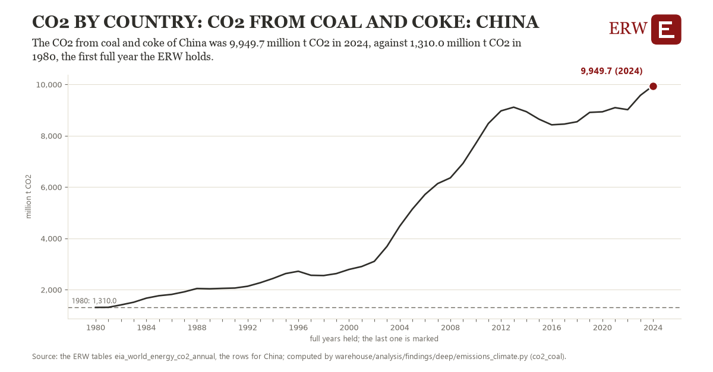

# Co2 by country: co2 from coal and coke: China

Draft `scan-deep-a33f01717c2b` of the findings hunt over the whole warehouse (chain 502), 2026-11-19. State: draft, not reviewed. Review at `/internal/findings`.

**The finding.** The CO2 from coal and coke of China was 9,949.7 million t CO2 in 2024, against 1,310.0 million t CO2 in 1980, the first full year the ERW holds.

**The figure by full year** (million t CO2): 1980: 1,310.0, 1981: 1,312.7, 1982: 1,407.8, 1983: 1,510.5, 1984: 1,669.3, 1985: 1,765.1, 1986: 1,816.2, 1987: 1,916.6, 1988: 2,046.9, 1989: 2,035.4, 1990: 2,052.1, 1991: 2,065.2, 1992: 2,134.5, 1993: 2,271.9, 1994: 2,437.6, 1995: 2,628.5, 1996: 2,718.6, 1997: 2,561.6, 1998: 2,551.4, 1999: 2,628.0, 2000: 2,789.7, 2001: 2,903.3, 2002: 3,105.5, 2003: 3,688.9, 2004: 4,473.0, 2005: 5,139.3, 2006: 5,712.1, 2007: 6,136.0, 2008: 6,359.0, 2009: 6,923.9, 2010: 7,691.7, 2011: 8,478.7, 2012: 8,970.7, 2013: 9,113.6, 2014: 8,939.8, 2015: 8,646.3, 2016: 8,426.8, 2017: 8,456.5, 2018: 8,546.3, 2019: 8,911.2, 2020: 8,933.8, 2021: 9,095.9, 2022: 9,017.5, 2023: 9,574.9, 2024: 9,949.7.

**The tables and rows.** `eia_world_energy_co2_annual`; the rows for China, region key `co2_chn` (the card's `hunt.region`), years 1980 to 2024. The yearly values: `co2-coal-co2-chn.csv`.

**Its strength.** The change is 36.90 typical yearly moves (a typical move is 234.1 million t CO2, 1.4826 times the median absolute change between full years). Holds in more than one year: 44 of the 44 full years after 1980 lie above 1980's value. Survives a change of window: from 1981 to 2024 the change is 8,637.0, from 1980 to 2023 it is 8,264.9. Sample large enough: 1980 holds 1 and 2024 holds 1 observations; the floor is 1. Half the change remains without the first year: from 1981 to 2024 the change is 8,637.0, 100.0 percent of the change from 1980. At least one typical yearly move: the change is 36.90 typical yearly moves (234.1 million t CO2 a year, the median move between full years); the floor is 1.

**Its limits.** EIA's international energy data as the latest bulk file holds them: CO2 from the energy a country consumes, not its land use or industrial processes; recent years are often EIA's estimates.

**Reproduce.** `python co2-coal-co2-chn.reproduce.py <the table's CSV>` and `do co2-coal-co2-chn.reproduce.do` (Stata) recompute the figures by year from the tables as the public downloads hold them; each names the expected values at its top.
