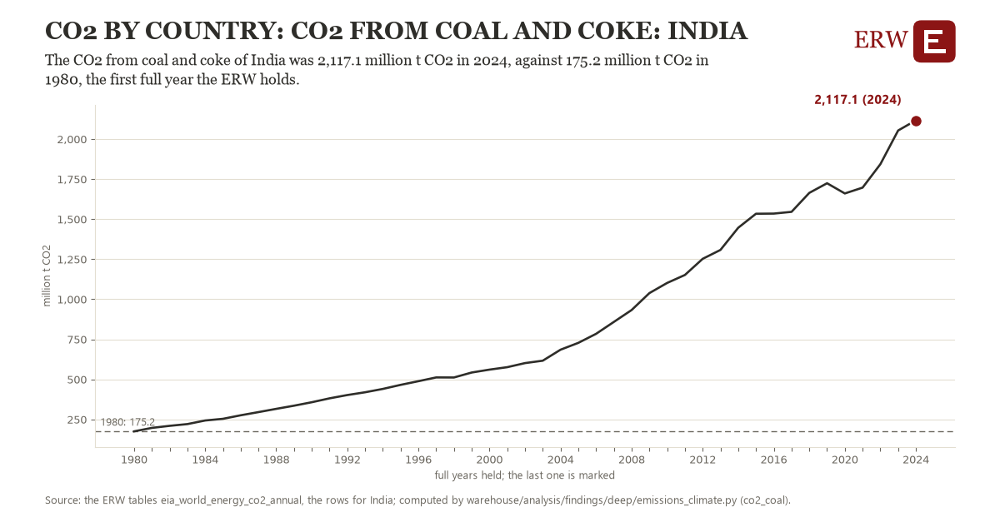

# Co2 by country: co2 from coal and coke: India

Draft `scan-deep-f414f9db7079` of the findings hunt over the whole warehouse (chain 502), 2026-11-19. State: draft, not reviewed. Review at `/internal/findings`.

**The finding.** The CO2 from coal and coke of India was 2,117.1 million t CO2 in 2024, against 175.2 million t CO2 in 1980, the first full year the ERW holds.

**The figure by full year** (million t CO2): 1980: 175.2, 1981: 196.8, 1982: 209.6, 1983: 220.6, 1984: 243.0, 1985: 253.4, 1986: 275.5, 1987: 295.4, 1988: 315.7, 1989: 335.4, 1990: 357.0, 1991: 381.3, 1992: 401.9, 1993: 419.2, 1994: 440.1, 1995: 465.4, 1996: 488.4, 1997: 511.8, 1998: 511.5, 1999: 542.5, 2000: 560.5, 2001: 575.8, 2002: 601.3, 2003: 616.3, 2004: 684.9, 2005: 727.6, 2006: 784.1, 2007: 858.4, 2008: 932.6, 2009: 1,038.3, 2010: 1,101.8, 2011: 1,151.6, 2012: 1,252.3, 2013: 1,307.9, 2014: 1,446.3, 2015: 1,533.8, 2016: 1,534.8, 2017: 1,545.6, 2018: 1,664.0, 2019: 1,724.2, 2020: 1,660.5, 2021: 1,696.9, 2022: 1,843.2, 2023: 2,053.5, 2024: 2,117.1.

**The tables and rows.** `eia_world_energy_co2_annual`; the rows for India, region key `co2_ind` (the card's `hunt.region`), years 1980 to 2024. The yearly values: `co2-coal-co2-ind.csv`.

**Its strength.** The change is 52.80 typical yearly moves (a typical move is 36.8 million t CO2, 1.4826 times the median absolute change between full years). Holds in more than one year: 44 of the 44 full years after 1980 lie above 1980's value. Survives a change of window: from 1981 to 2024 the change is 1,920.3, from 1980 to 2023 it is 1,878.3. Sample large enough: 1980 holds 1 and 2024 holds 1 observations; the floor is 1. Half the change remains without the first year: from 1981 to 2024 the change is 1,920.3, 98.9 percent of the change from 1980. At least one typical yearly move: the change is 52.80 typical yearly moves (36.8 million t CO2 a year, the median move between full years); the floor is 1.

**Its limits.** EIA's international energy data as the latest bulk file holds them: CO2 from the energy a country consumes, not its land use or industrial processes; recent years are often EIA's estimates.

**Reproduce.** `python co2-coal-co2-ind.reproduce.py <the table's CSV>` and `do co2-coal-co2-ind.reproduce.do` (Stata) recompute the figures by year from the tables as the public downloads hold them; each names the expected values at its top.
