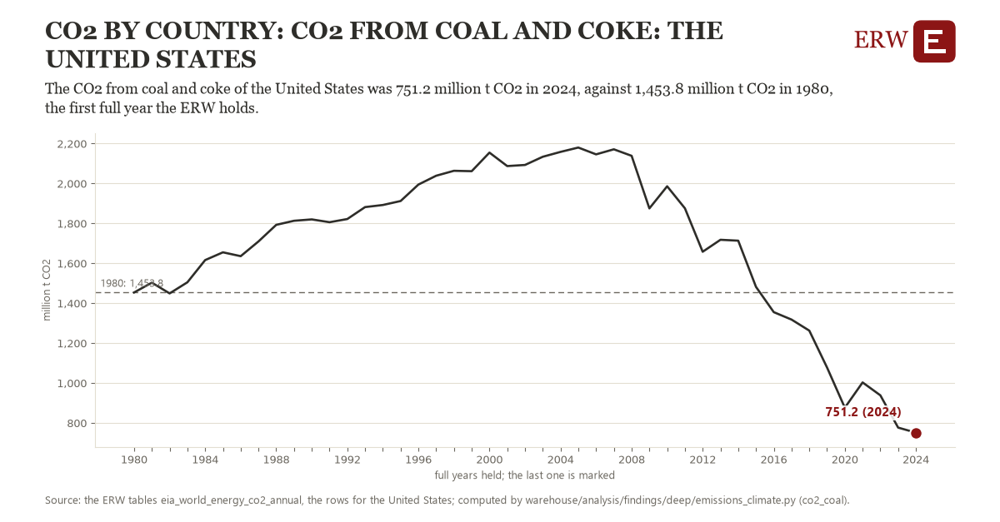

# Co2 by country: co2 from coal and coke: the United States

Draft `scan-deep-0cb24ac523f2` of the findings hunt over the whole warehouse (chain 502), 2026-11-19. State: draft, not reviewed. Review at `/internal/findings`.

**The finding.** The CO2 from coal and coke of the United States was 751.2 million t CO2 in 2024, against 1,453.8 million t CO2 in 1980, the first full year the ERW holds.

**The figure by full year** (million t CO2): 1980: 1,453.8, 1981: 1,502.9, 1982: 1,449.1, 1983: 1,504.8, 1984: 1,616.1, 1985: 1,655.0, 1986: 1,635.7, 1987: 1,709.5, 1988: 1,792.7, 1989: 1,813.1, 1990: 1,820.0, 1991: 1,805.9, 1992: 1,821.9, 1993: 1,881.7, 1994: 1,892.2, 1995: 1,912.1, 1996: 1,994.5, 1997: 2,038.8, 1998: 2,063.6, 1999: 2,061.6, 2000: 2,154.7, 2001: 2,087.3, 2002: 2,092.9, 2003: 2,133.9, 2004: 2,158.4, 2005: 2,180.1, 2006: 2,146.0, 2007: 2,171.3, 2008: 2,138.7, 2009: 1,875.2, 2010: 1,985.9, 2011: 1,875.6, 2012: 1,657.9, 2013: 1,717.8, 2014: 1,713.4, 2015: 1,481.9, 2016: 1,355.2, 2017: 1,318.0, 2018: 1,262.6, 2019: 1,077.5, 2020: 876.2, 2021: 1,002.9, 2022: 938.2, 2023: 776.5, 2024: 751.2.

**The tables and rows.** `eia_world_energy_co2_annual`; the rows for the United States, region key `co2_usa` (the card's `hunt.region`), years 1980 to 2024. The yearly values: `co2-coal-co2-usa.csv`.

**Its strength.** The change is 9.20 typical yearly moves (a typical move is 76.3 million t CO2, 1.4826 times the median absolute change between full years). Holds in more than one year: 10 of the 44 full years after 1980 lie below 1980's value. Survives a change of window: from 1981 to 2024 the change is -751.7, from 1980 to 2023 it is -677.3. Sample large enough: 1980 holds 1 and 2024 holds 1 observations; the floor is 1. Half the change remains without the first year: from 1981 to 2024 the change is -751.7, 107.0 percent of the change from 1980. At least one typical yearly move: the change is 9.20 typical yearly moves (76.3 million t CO2 a year, the median move between full years); the floor is 1.

**Its limits.** EIA's international energy data as the latest bulk file holds them: CO2 from the energy a country consumes, not its land use or industrial processes; recent years are often EIA's estimates.

**Reproduce.** `python co2-coal-co2-usa.reproduce.py <the table's CSV>` and `do co2-coal-co2-usa.reproduce.do` (Stata) recompute the figures by year from the tables as the public downloads hold them; each names the expected values at its top.
