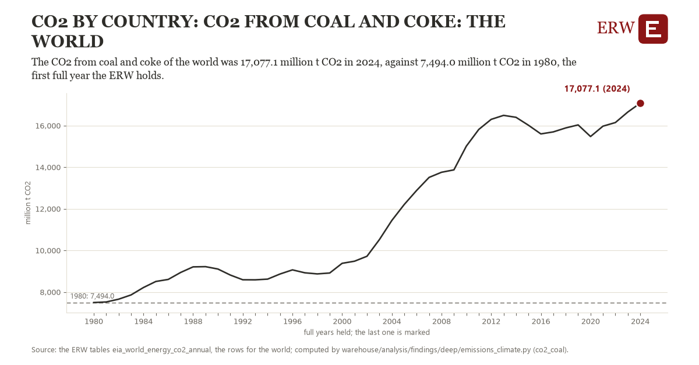

# Co2 by country: co2 from coal and coke: the world

Draft `scan-deep-b3345081b769` of the findings hunt over the whole warehouse (chain 502), 2026-11-19. State: draft, not reviewed. Review at `/internal/findings`.

**The finding.** The CO2 from coal and coke of the world was 17,077.1 million t CO2 in 2024, against 7,494.0 million t CO2 in 1980, the first full year the ERW holds.

**The figure by full year** (million t CO2): 1980: 7,494.0, 1981: 7,520.3, 1982: 7,653.5, 1983: 7,857.7, 1984: 8,213.5, 1985: 8,505.8, 1986: 8,604.8, 1987: 8,939.6, 1988: 9,207.8, 1989: 9,218.3, 1990: 9,103.8, 1991: 8,814.0, 1992: 8,587.8, 1993: 8,584.7, 1994: 8,618.4, 1995: 8,864.7, 1996: 9,063.5, 1997: 8,922.3, 1998: 8,869.5, 1999: 8,912.9, 2000: 9,378.5, 2001: 9,480.5, 2002: 9,717.7, 2003: 10,518.2, 2004: 11,437.3, 2005: 12,206.1, 2006: 12,883.6, 2007: 13,508.2, 2008: 13,754.9, 2009: 13,870.6, 2010: 15,011.3, 2011: 15,813.1, 2012: 16,298.6, 2013: 16,490.7, 2014: 16,396.9, 2015: 16,016.8, 2016: 15,599.3, 2017: 15,695.5, 2018: 15,886.2, 2019: 16,031.9, 2020: 15,473.6, 2021: 15,971.1, 2022: 16,145.4, 2023: 16,650.5, 2024: 17,077.1.

**The tables and rows.** `eia_world_energy_co2_annual`; the rows for the world, region key `co2_worl` (the card's `hunt.region`), years 1980 to 2024. The yearly values: `co2-coal-co2-worl.csv`.

**Its strength.** The change is 26.74 typical yearly moves (a typical move is 358.4 million t CO2, 1.4826 times the median absolute change between full years). Holds in more than one year: 44 of the 44 full years after 1980 lie above 1980's value. Survives a change of window: from 1981 to 2024 the change is 9,556.8, from 1980 to 2023 it is 9,156.6. Sample large enough: 1980 holds 1 and 2024 holds 1 observations; the floor is 1. Half the change remains without the first year: from 1981 to 2024 the change is 9,556.8, 99.7 percent of the change from 1980. At least one typical yearly move: the change is 26.74 typical yearly moves (358.4 million t CO2 a year, the median move between full years); the floor is 1.

**Its limits.** EIA's international energy data as the latest bulk file holds them: CO2 from the energy a country consumes, not its land use or industrial processes; recent years are often EIA's estimates.

**Reproduce.** `python co2-coal-co2-worl.reproduce.py <the table's CSV>` and `do co2-coal-co2-worl.reproduce.do` (Stata) recompute the figures by year from the tables as the public downloads hold them; each names the expected values at its top.
