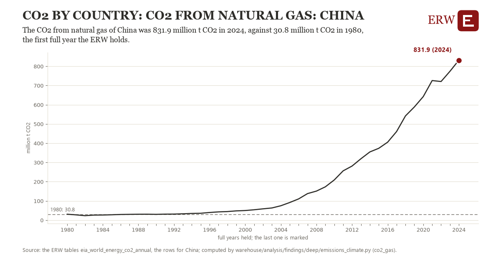

# Co2 by country: co2 from natural gas: China

Draft `scan-deep-a2fb435c85d9` of the findings hunt over the whole warehouse (chain 502), 2026-11-19. State: draft, not reviewed. Review at `/internal/findings`.

**The finding.** The CO2 from natural gas of China was 831.9 million t CO2 in 2024, against 30.8 million t CO2 in 1980, the first full year the ERW holds.

**The figure by full year** (million t CO2): 1980: 30.8, 1981: 27.5, 1982: 23.3, 1983: 26.3, 1984: 26.7, 1985: 27.9, 1986: 29.6, 1987: 30.2, 1988: 30.7, 1989: 30.8, 1990: 30.2, 1991: 31.2, 1992: 31.6, 1993: 33.0, 1994: 34.8, 1995: 35.9, 1996: 39.8, 1997: 43.0, 1998: 44.7, 1999: 48.2, 2000: 50.0, 2001: 54.0, 2002: 58.8, 2003: 63.4, 2004: 74.9, 2005: 91.7, 2006: 110.5, 2007: 138.1, 2008: 151.1, 2009: 173.3, 2010: 208.9, 2011: 256.3, 2012: 281.3, 2013: 319.4, 2014: 354.7, 2015: 373.6, 2016: 405.5, 2017: 460.5, 2018: 542.0, 2019: 588.6, 2020: 642.5, 2021: 725.9, 2022: 720.9, 2023: 774.1, 2024: 831.9.

**The tables and rows.** `eia_world_energy_co2_annual`; the rows for China, region key `co2_chn` (the card's `hunt.region`), years 1980 to 2024. The yearly values: `co2-gas-co2-chn.csv`.

**Its strength.** The change is 115.20 typical yearly moves (a typical move is 7.0 million t CO2, 1.4826 times the median absolute change between full years). Holds in more than one year: 34 of the 44 full years after 1980 lie above 1980's value. Survives a change of window: from 1981 to 2024 the change is 804.4, from 1980 to 2023 it is 743.2. Sample large enough: 1980 holds 1 and 2024 holds 1 observations; the floor is 1. Half the change remains without the first year: from 1981 to 2024 the change is 804.4, 100.4 percent of the change from 1980. At least one typical yearly move: the change is 115.20 typical yearly moves (7.0 million t CO2 a year, the median move between full years); the floor is 1.

**Its limits.** EIA's international energy data as the latest bulk file holds them: CO2 from the energy a country consumes, not its land use or industrial processes; recent years are often EIA's estimates.

**Reproduce.** `python co2-gas-co2-chn.reproduce.py <the table's CSV>` and `do co2-gas-co2-chn.reproduce.do` (Stata) recompute the figures by year from the tables as the public downloads hold them; each names the expected values at its top.
