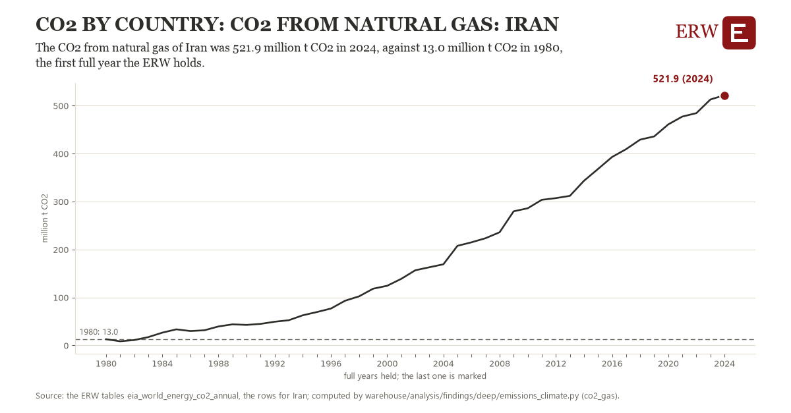

# Co2 by country: co2 from natural gas: Iran

Draft `scan-deep-dd61393bae46` of the findings hunt over the whole warehouse (chain 502), 2026-11-19. State: draft, not reviewed. Review at `/internal/findings`.

**The finding.** The CO2 from natural gas of Iran was 521.9 million t CO2 in 2024, against 13.0 million t CO2 in 1980, the first full year the ERW holds.

**The figure by full year** (million t CO2): 1980: 13.0, 1981: 8.7, 1982: 11.2, 1983: 17.4, 1984: 26.7, 1985: 33.6, 1986: 30.0, 1987: 31.7, 1988: 39.6, 1989: 44.0, 1990: 42.8, 1991: 45.0, 1992: 49.5, 1993: 52.6, 1994: 62.9, 1995: 69.6, 1996: 77.0, 1997: 93.2, 1998: 102.4, 1999: 118.3, 2000: 124.4, 2001: 138.9, 2002: 156.8, 2003: 163.0, 2004: 169.3, 2005: 207.7, 2006: 215.1, 2007: 223.7, 2008: 236.0, 2009: 279.8, 2010: 286.1, 2011: 303.7, 2012: 307.3, 2013: 312.0, 2014: 343.3, 2015: 368.0, 2016: 393.0, 2017: 409.4, 2018: 429.3, 2019: 436.0, 2020: 461.0, 2021: 477.3, 2022: 484.5, 2023: 513.0, 2024: 521.9.

**The tables and rows.** `eia_world_energy_co2_annual`; the rows for Iran, region key `co2_irn` (the card's `hunt.region`), years 1980 to 2024. The yearly values: `co2-gas-co2-irn.csv`.

**Its strength.** The change is 44.71 typical yearly moves (a typical move is 11.4 million t CO2, 1.4826 times the median absolute change between full years). Holds in more than one year: 42 of the 44 full years after 1980 lie above 1980's value. Survives a change of window: from 1981 to 2024 the change is 513.2, from 1980 to 2023 it is 500.0. Sample large enough: 1980 holds 1 and 2024 holds 1 observations; the floor is 1. Half the change remains without the first year: from 1981 to 2024 the change is 513.2, 100.8 percent of the change from 1980. At least one typical yearly move: the change is 44.71 typical yearly moves (11.4 million t CO2 a year, the median move between full years); the floor is 1.

**Its limits.** EIA's international energy data as the latest bulk file holds them: CO2 from the energy a country consumes, not its land use or industrial processes; recent years are often EIA's estimates.

**Reproduce.** `python co2-gas-co2-irn.reproduce.py <the table's CSV>` and `do co2-gas-co2-irn.reproduce.do` (Stata) recompute the figures by year from the tables as the public downloads hold them; each names the expected values at its top.
