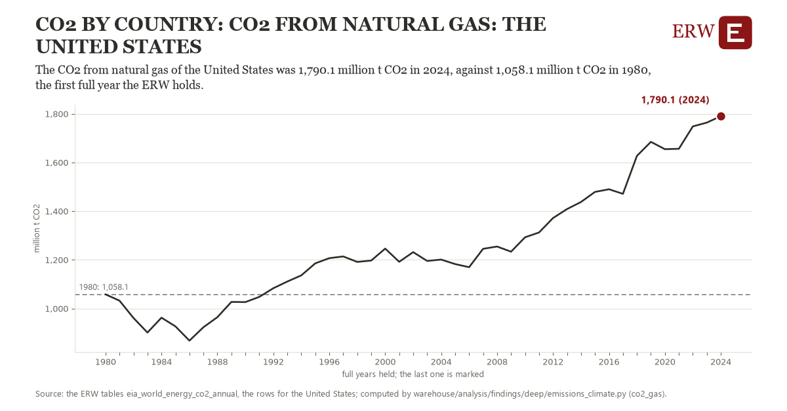

# Co2 by country: co2 from natural gas: the United States

Draft `scan-deep-0b0551d5e652` of the findings hunt over the whole warehouse (chain 502), 2026-11-19. State: draft, not reviewed. Review at `/internal/findings`.

**The finding.** The CO2 from natural gas of the United States was 1,790.1 million t CO2 in 2024, against 1,058.1 million t CO2 in 1980, the first full year the ERW holds.

**The figure by full year** (million t CO2): 1980: 1,058.1, 1981: 1,032.1, 1982: 960.9, 1983: 901.1, 1984: 962.3, 1985: 926.5, 1986: 867.9, 1987: 923.0, 1988: 964.4, 1989: 1,027.0, 1990: 1,026.3, 1991: 1,047.8, 1992: 1,083.3, 1993: 1,110.7, 1994: 1,136.0, 1995: 1,185.4, 1996: 1,206.7, 1997: 1,213.8, 1998: 1,191.3, 1999: 1,196.9, 2000: 1,246.0, 2001: 1,191.8, 2002: 1,231.5, 2003: 1,195.4, 2004: 1,200.9, 2005: 1,182.5, 2006: 1,169.7, 2007: 1,245.2, 2008: 1,254.5, 2009: 1,233.4, 2010: 1,292.4, 2011: 1,312.3, 2012: 1,371.6, 2013: 1,408.4, 2014: 1,437.5, 2015: 1,478.9, 2016: 1,489.9, 2017: 1,471.0, 2018: 1,626.9, 2019: 1,684.6, 2020: 1,654.6, 2021: 1,656.1, 2022: 1,748.1, 2023: 1,763.7, 2024: 1,790.1.

**The tables and rows.** `eia_world_energy_co2_annual`; the rows for the United States, region key `co2_usa` (the card's `hunt.region`), years 1980 to 2024. The yearly values: `co2-gas-co2-usa.csv`.

**Its strength.** The change is 15.06 typical yearly moves (a typical move is 48.6 million t CO2, 1.4826 times the median absolute change between full years). Holds in more than one year: 33 of the 44 full years after 1980 lie above 1980's value. Survives a change of window: from 1981 to 2024 the change is 758.0, from 1980 to 2023 it is 705.6. Sample large enough: 1980 holds 1 and 2024 holds 1 observations; the floor is 1. Half the change remains without the first year: from 1981 to 2024 the change is 758.0, 103.5 percent of the change from 1980. At least one typical yearly move: the change is 15.06 typical yearly moves (48.6 million t CO2 a year, the median move between full years); the floor is 1.

**Its limits.** EIA's international energy data as the latest bulk file holds them: CO2 from the energy a country consumes, not its land use or industrial processes; recent years are often EIA's estimates.

**Reproduce.** `python co2-gas-co2-usa.reproduce.py <the table's CSV>` and `do co2-gas-co2-usa.reproduce.do` (Stata) recompute the figures by year from the tables as the public downloads hold them; each names the expected values at its top.
