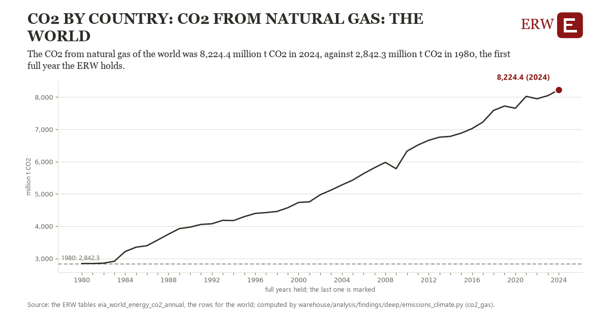

# Co2 by country: co2 from natural gas: the world

Draft `scan-deep-cf8fa7dc7b5f` of the findings hunt over the whole warehouse (chain 502), 2026-11-19. State: draft, not reviewed. Review at `/internal/findings`.

**The finding.** The CO2 from natural gas of the world was 8,224.4 million t CO2 in 2024, against 2,842.3 million t CO2 in 1980, the first full year the ERW holds.

**The figure by full year** (million t CO2): 1980: 2,842.3, 1981: 2,843.9, 1982: 2,855.0, 1983: 2,913.5, 1984: 3,214.5, 1985: 3,349.5, 1986: 3,395.1, 1987: 3,571.7, 1988: 3,753.1, 1989: 3,925.3, 1990: 3,972.0, 1991: 4,055.9, 1992: 4,075.5, 1993: 4,181.7, 1994: 4,174.8, 1995: 4,297.4, 1996: 4,396.2, 1997: 4,422.5, 1998: 4,456.6, 1999: 4,571.9, 2000: 4,736.2, 2001: 4,755.0, 2002: 4,974.7, 2003: 5,119.3, 2004: 5,279.5, 2005: 5,429.2, 2006: 5,630.3, 2007: 5,811.1, 2008: 5,978.1, 2009: 5,782.1, 2010: 6,324.8, 2011: 6,513.9, 2012: 6,662.1, 2013: 6,759.1, 2014: 6,783.6, 2015: 6,883.3, 2016: 7,023.6, 2017: 7,227.3, 2018: 7,589.3, 2019: 7,724.4, 2020: 7,655.8, 2021: 8,023.8, 2022: 7,948.5, 2023: 8,046.1, 2024: 8,224.4.

**The tables and rows.** `eia_world_energy_co2_annual`; the rows for the world, region key `co2_worl` (the card's `hunt.region`), years 1980 to 2024. The yearly values: `co2-gas-co2-worl.csv`.

**Its strength.** The change is 26.88 typical yearly moves (a typical move is 200.2 million t CO2, 1.4826 times the median absolute change between full years). Holds in more than one year: 44 of the 44 full years after 1980 lie above 1980's value. Survives a change of window: from 1981 to 2024 the change is 5,380.5, from 1980 to 2023 it is 5,203.8. Sample large enough: 1980 holds 1 and 2024 holds 1 observations; the floor is 1. Half the change remains without the first year: from 1981 to 2024 the change is 5,380.5, 100.0 percent of the change from 1980. At least one typical yearly move: the change is 26.88 typical yearly moves (200.2 million t CO2 a year, the median move between full years); the floor is 1.

**Its limits.** EIA's international energy data as the latest bulk file holds them: CO2 from the energy a country consumes, not its land use or industrial processes; recent years are often EIA's estimates.

**Reproduce.** `python co2-gas-co2-worl.reproduce.py <the table's CSV>` and `do co2-gas-co2-worl.reproduce.do` (Stata) recompute the figures by year from the tables as the public downloads hold them; each names the expected values at its top.
