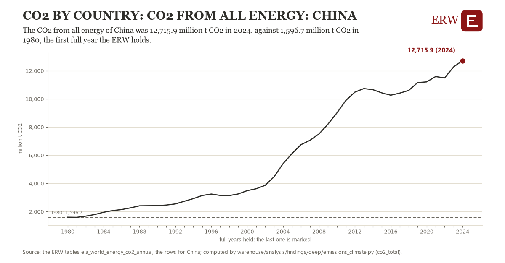

# Co2 by country: co2 from all energy: China

Draft `scan-deep-219a4092f007` of the findings hunt over the whole warehouse (chain 502), 2026-11-19. State: draft, not reviewed. Review at `/internal/findings`.

**The finding.** The CO2 from all energy of China was 12,715.9 million t CO2 in 2024, against 1,596.7 million t CO2 in 1980, the first full year the ERW holds.

**The figure by full year** (million t CO2): 1980: 1,596.7, 1981: 1,587.2, 1982: 1,671.1, 1983: 1,785.8, 1984: 1,948.1, 1985: 2,067.0, 1986: 2,139.8, 1987: 2,259.8, 1988: 2,405.7, 1989: 2,413.2, 1990: 2,417.2, 1991: 2,460.4, 1992: 2,541.1, 1993: 2,730.9, 1994: 2,916.4, 1995: 3,140.3, 1996: 3,240.4, 1997: 3,143.6, 1998: 3,132.1, 1999: 3,248.3, 2000: 3,482.7, 2001: 3,615.3, 2002: 3,857.3, 2003: 4,469.3, 2004: 5,397.9, 2005: 6,120.1, 2006: 6,750.7, 2007: 7,057.6, 2008: 7,505.1, 2009: 8,204.1, 2010: 9,003.7, 2011: 9,892.5, 2012: 10,479.0, 2013: 10,732.0, 2014: 10,654.3, 2015: 10,427.1, 2016: 10,261.6, 2017: 10,408.1, 2018: 10,601.9, 2019: 11,155.6, 2020: 11,205.8, 2021: 11,583.5, 2022: 11,486.2, 2023: 12,265.3, 2024: 12,715.9.

**The tables and rows.** `eia_world_energy_co2_annual`; the rows for China, region key `co2_chn` (the card's `hunt.region`), years 1980 to 2024. The yearly values: `co2-total-co2-chn.csv`.

**Its strength.** The change is 42.74 typical yearly moves (a typical move is 260.2 million t CO2, 1.4826 times the median absolute change between full years). Holds in more than one year: 43 of the 44 full years after 1980 lie above 1980's value. Survives a change of window: from 1981 to 2024 the change is 11,128.8, from 1980 to 2023 it is 10,668.6. Sample large enough: 1980 holds 1 and 2024 holds 1 observations; the floor is 1. Half the change remains without the first year: from 1981 to 2024 the change is 11,128.8, 100.1 percent of the change from 1980. At least one typical yearly move: the change is 42.74 typical yearly moves (260.2 million t CO2 a year, the median move between full years); the floor is 1.

**Its limits.** EIA's international energy data as the latest bulk file holds them: CO2 from the energy a country consumes, not its land use or industrial processes; recent years are often EIA's estimates.

**Reproduce.** `python co2-total-co2-chn.reproduce.py <the table's CSV>` and `do co2-total-co2-chn.reproduce.do` (Stata) recompute the figures by year from the tables as the public downloads hold them; each names the expected values at its top.
