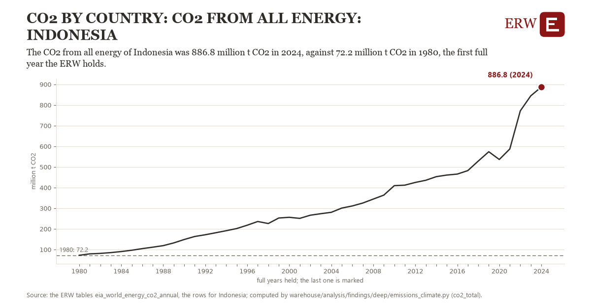

# Co2 by country: co2 from all energy: Indonesia

Draft `scan-deep-6037e2f7f846` of the findings hunt over the whole warehouse (chain 502), 2026-11-19. State: draft, not reviewed. Review at `/internal/findings`.

**The finding.** The CO2 from all energy of Indonesia was 886.8 million t CO2 in 2024, against 72.2 million t CO2 in 1980, the first full year the ERW holds.

**The figure by full year** (million t CO2): 1980: 72.2, 1981: 79.0, 1982: 81.3, 1983: 85.1, 1984: 90.2, 1985: 96.6, 1986: 104.4, 1987: 111.4, 1988: 118.9, 1989: 132.1, 1990: 148.6, 1991: 163.2, 1992: 171.6, 1993: 181.3, 1994: 191.2, 1995: 201.7, 1996: 217.9, 1997: 235.8, 1998: 225.9, 1999: 252.7, 2000: 256.0, 2001: 250.9, 2002: 266.2, 2003: 273.6, 2004: 280.2, 2005: 300.7, 2006: 311.0, 2007: 325.1, 2008: 344.4, 2009: 363.4, 2010: 409.4, 2011: 411.7, 2012: 424.9, 2013: 435.4, 2014: 452.9, 2015: 460.6, 2016: 465.4, 2017: 482.1, 2018: 528.6, 2019: 573.6, 2020: 536.1, 2021: 586.9, 2022: 771.6, 2023: 844.4, 2024: 886.8.

**The tables and rows.** `eia_world_energy_co2_annual`; the rows for Indonesia, region key `co2_idn` (the card's `hunt.region`), years 1980 to 2024. The yearly values: `co2-total-co2-idn.csv`.

**Its strength.** The change is 46.48 typical yearly moves (a typical move is 17.5 million t CO2, 1.4826 times the median absolute change between full years). Holds in more than one year: 44 of the 44 full years after 1980 lie above 1980's value. Survives a change of window: from 1981 to 2024 the change is 807.8, from 1980 to 2023 it is 772.2. Sample large enough: 1980 holds 1 and 2024 holds 1 observations; the floor is 1. Half the change remains without the first year: from 1981 to 2024 the change is 807.8, 99.2 percent of the change from 1980. At least one typical yearly move: the change is 46.48 typical yearly moves (17.5 million t CO2 a year, the median move between full years); the floor is 1.

**Its limits.** EIA's international energy data as the latest bulk file holds them: CO2 from the energy a country consumes, not its land use or industrial processes; recent years are often EIA's estimates.

**Reproduce.** `python co2-total-co2-idn.reproduce.py <the table's CSV>` and `do co2-total-co2-idn.reproduce.do` (Stata) recompute the figures by year from the tables as the public downloads hold them; each names the expected values at its top.
