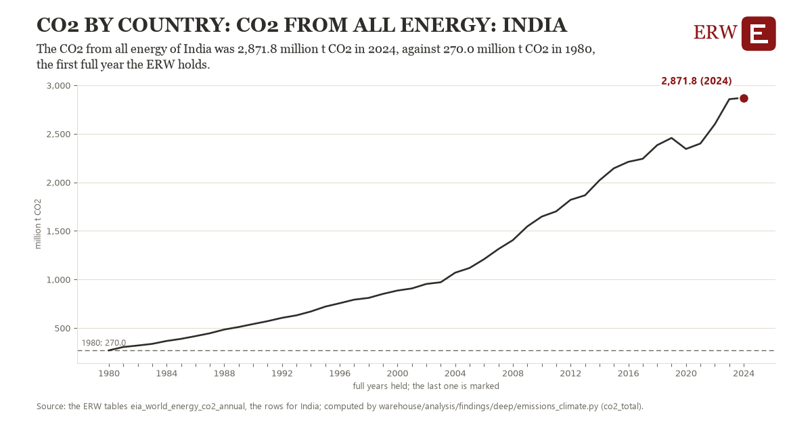

# Co2 by country: co2 from all energy: India

Draft `scan-deep-d2a51e0b9f3d` of the findings hunt over the whole warehouse (chain 502), 2026-11-19. State: draft, not reviewed. Review at `/internal/findings`.

**The finding.** The CO2 from all energy of India was 2,871.8 million t CO2 in 2024, against 270.0 million t CO2 in 1980, the first full year the ERW holds.

**The figure by full year** (million t CO2): 1980: 270.0, 1981: 304.7, 1982: 319.9, 1983: 336.9, 1984: 366.7, 1985: 388.5, 1986: 416.5, 1987: 446.2, 1988: 484.6, 1989: 510.6, 1990: 541.3, 1991: 570.7, 1992: 605.0, 1993: 630.6, 1994: 670.4, 1995: 720.7, 1996: 755.6, 1997: 792.2, 1998: 810.2, 1999: 851.8, 2000: 886.0, 2001: 907.7, 2002: 953.8, 2003: 971.5, 2004: 1,069.9, 2005: 1,118.6, 2006: 1,208.6, 2007: 1,313.5, 2008: 1,405.3, 2009: 1,546.5, 2010: 1,647.6, 2011: 1,701.4, 2012: 1,820.4, 2013: 1,866.8, 2014: 2,020.9, 2015: 2,145.0, 2016: 2,211.6, 2017: 2,243.1, 2018: 2,383.3, 2019: 2,457.7, 2020: 2,344.3, 2021: 2,400.4, 2022: 2,599.6, 2023: 2,857.2, 2024: 2,871.8.

**The tables and rows.** `eia_world_energy_co2_annual`; the rows for India, region key `co2_ind` (the card's `hunt.region`), years 1980 to 2024. The yearly values: `co2-total-co2-ind.csv`.

**Its strength.** The change is 43.17 typical yearly moves (a typical move is 60.3 million t CO2, 1.4826 times the median absolute change between full years). Holds in more than one year: 44 of the 44 full years after 1980 lie above 1980's value. Survives a change of window: from 1981 to 2024 the change is 2,567.1, from 1980 to 2023 it is 2,587.2. Sample large enough: 1980 holds 1 and 2024 holds 1 observations; the floor is 1. Half the change remains without the first year: from 1981 to 2024 the change is 2,567.1, 98.7 percent of the change from 1980. At least one typical yearly move: the change is 43.17 typical yearly moves (60.3 million t CO2 a year, the median move between full years); the floor is 1.

**Its limits.** EIA's international energy data as the latest bulk file holds them: CO2 from the energy a country consumes, not its land use or industrial processes; recent years are often EIA's estimates.

**Reproduce.** `python co2-total-co2-ind.reproduce.py <the table's CSV>` and `do co2-total-co2-ind.reproduce.do` (Stata) recompute the figures by year from the tables as the public downloads hold them; each names the expected values at its top.
