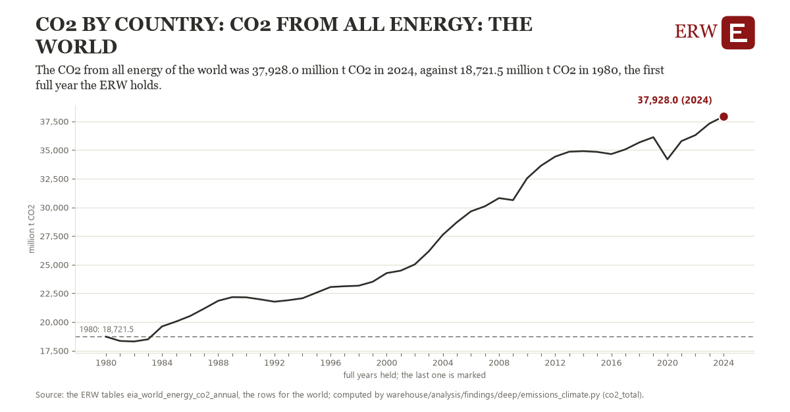

# Co2 by country: co2 from all energy: the world

Draft `scan-deep-06890168c703` of the findings hunt over the whole warehouse (chain 502), 2026-11-19. State: draft, not reviewed. Review at `/internal/findings`.

**The finding.** The CO2 from all energy of the world was 37,928.0 million t CO2 in 2024, against 18,721.5 million t CO2 in 1980, the first full year the ERW holds.

**The figure by full year** (million t CO2): 1980: 18,721.5, 1981: 18,347.2, 1982: 18,300.5, 1983: 18,488.8, 1984: 19,615.5, 1985: 20,040.9, 1986: 20,523.7, 1987: 21,172.6, 1988: 21,849.1, 1989: 22,168.7, 1990: 22,150.0, 1991: 21,972.3, 1992: 21,770.7, 1993: 21,897.9, 1994: 22,068.8, 1995: 22,558.2, 1996: 23,050.1, 1997: 23,118.3, 1998: 23,164.2, 1999: 23,507.9, 2000: 24,265.7, 2001: 24,477.8, 2002: 25,021.1, 2003: 26,165.2, 2004: 27,610.1, 2005: 28,701.0, 2006: 29,648.3, 2007: 30,093.3, 2008: 30,804.7, 2009: 30,628.0, 2010: 32,530.9, 2011: 33,637.8, 2012: 34,423.2, 2013: 34,851.8, 2014: 34,902.0, 2015: 34,836.3, 2016: 34,647.5, 2017: 35,055.5, 2018: 35,663.2, 2019: 36,119.1, 2020: 34,186.1, 2021: 35,779.3, 2022: 36,304.6, 2023: 37,314.8, 2024: 37,928.0.

**The tables and rows.** `eia_world_energy_co2_annual`; the rows for the world, region key `co2_worl` (the card's `hunt.region`), years 1980 to 2024. The yearly values: `co2-total-co2-worl.csv`.

**Its strength.** The change is 27.60 typical yearly moves (a typical move is 695.9 million t CO2, 1.4826 times the median absolute change between full years). Holds in more than one year: 41 of the 44 full years after 1980 lie above 1980's value. Survives a change of window: from 1981 to 2024 the change is 19,580.8, from 1980 to 2023 it is 18,593.2. Sample large enough: 1980 holds 1 and 2024 holds 1 observations; the floor is 1. Half the change remains without the first year: from 1981 to 2024 the change is 19,580.8, 101.9 percent of the change from 1980. At least one typical yearly move: the change is 27.60 typical yearly moves (695.9 million t CO2 a year, the median move between full years); the floor is 1.

**Its limits.** EIA's international energy data as the latest bulk file holds them: CO2 from the energy a country consumes, not its land use or industrial processes; recent years are often EIA's estimates.

**Reproduce.** `python co2-total-co2-worl.reproduce.py <the table's CSV>` and `do co2-total-co2-worl.reproduce.do` (Stata) recompute the figures by year from the tables as the public downloads hold them; each names the expected values at its top.
