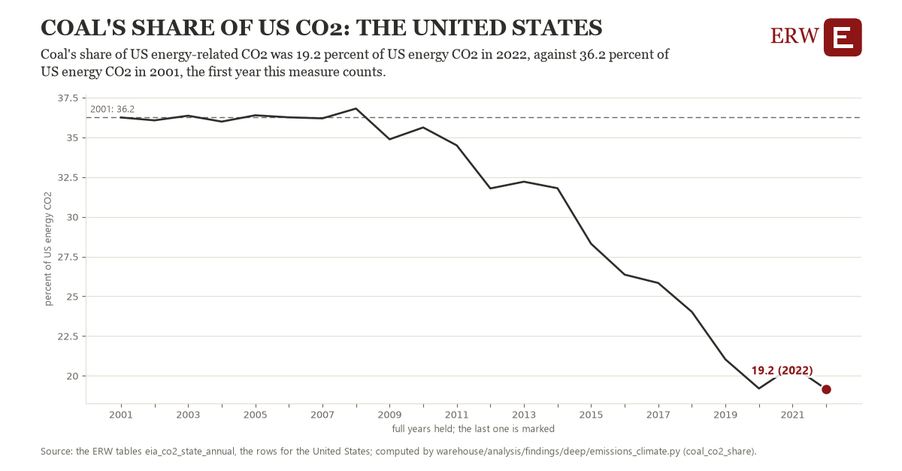

# Coal's share of us co2: the United States

Draft `scan-deep-fed28b9d315c` of the findings hunt over the whole warehouse (chain 164), 2026-11-06. State: draft, not reviewed. Review at `/internal/findings`.

**The finding.** Coal's share of US energy-related CO2 was 19.2 percent of US energy CO2 in 2022, against 36.2 percent of US energy CO2 in 2001, the first year this measure counts.

**The figure by full year** (percent of US energy CO2): 2001: 36.2, 2002: 36.1, 2003: 36.4, 2004: 36.0, 2005: 36.4, 2006: 36.3, 2007: 36.2, 2008: 36.8, 2009: 34.9, 2010: 35.6, 2011: 34.5, 2012: 31.8, 2013: 32.2, 2014: 31.8, 2015: 28.3, 2016: 26.4, 2017: 25.8, 2018: 24.0, 2019: 21.0, 2020: 19.2, 2021: 20.6, 2022: 19.2.

**The tables and rows.** `eia_co2_state_annual`; the rows for the United States, region key `us_coal_co2_share` (the card's `hunt.region`), years 2001 to 2022. The yearly values: `coal-co2-share-us-coal-co2-share.csv`.

**Its strength.** The change is 15.48 typical yearly moves (a typical move is 1.1 percent of US energy CO2, 1.4826 times the median absolute change between full years). Holds in more than one year: 17 of the 21 full years after 2001 lie below 2001's value. Survives a change of window: from 2002 to 2022 the change is -16.9, from 2001 to 2021 it is -15.6. Sample large enough: 2001 holds 1 and 2022 holds 1 observations; the floor is 1. Half the change remains without the first year: from 2002 to 2022 the change is -16.9, 98.9 percent of the change from 2001. At least one typical yearly move: the change is 15.48 typical yearly moves (1.1 percent of US energy CO2 a year, the median move between full years); the floor is 1.

**Its limits.** EIA's energy-related CO2 by state, which ends in 2022 in the ERW's table; it counts fuel burned, not the electricity a state imports.

**Reproduce.** `python coal-co2-share-us-coal-co2-share.reproduce.py <the table's CSV>` and `do coal-co2-share-us-coal-co2-share.reproduce.do` (Stata) recompute the figures by year from the tables as the public downloads hold them; each names the expected values at its top.
