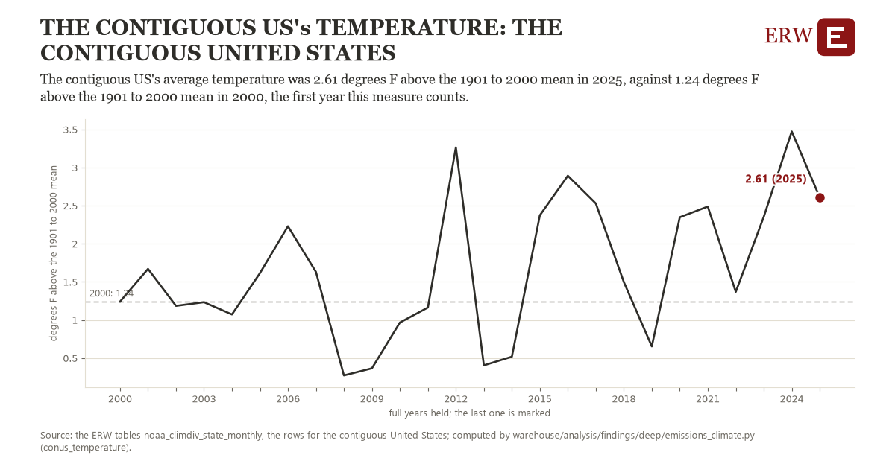

# The contiguous us's temperature: the contiguous United States

Draft `scan-deep-0cc95d0b9b3b` of the findings hunt over the whole warehouse (chain 164), 2026-11-06. State: draft, not reviewed. Review at `/internal/findings`.

**The finding.** The contiguous US's average temperature was 2.61 degrees F above the 1901 to 2000 mean in 2025, against 1.24 degrees F above the 1901 to 2000 mean in 2000, the first year this measure counts.

**The figure by full year** (degrees F above the 1901 to 2000 mean): 2000: 1.24, 2001: 1.67, 2002: 1.18, 2003: 1.23, 2004: 1.07, 2005: 1.62, 2006: 2.23, 2007: 1.63, 2008: 0.27, 2009: 0.37, 2010: 0.97, 2011: 1.16, 2012: 3.26, 2013: 0.40, 2014: 0.52, 2015: 2.37, 2016: 2.89, 2017: 2.53, 2018: 1.50, 2019: 0.65, 2020: 2.35, 2021: 2.49, 2022: 1.37, 2023: 2.35, 2024: 3.47, 2025: 2.61.

**The tables and rows.** `noaa_climdiv_state_monthly`; the rows for the contiguous United States, region key `conus_temp` (the card's `hunt.region`), years 2000 to 2025. The yearly values: `conus-temperature-conus-temp.csv`.

**Its strength.** The change is 1.53 typical yearly moves (a typical move is 0.89 degrees F above the 1901 to 2000 mean, 1.4826 times the median absolute change between full years). Holds in more than one year: 15 of the 25 full years after 2000 lie above 2000's value. Survives a change of window: from 2001 to 2025 the change is 0.94, from 2000 to 2024 it is 2.23. Sample large enough: 2000 holds 12 and 2025 holds 12 observations; the floor is 11. Half the change remains without the first year: from 2001 to 2025 the change is 0.94, 68.6 percent of the change from 2000. At least one typical yearly move: the change is 1.53 typical yearly moves (0.89 degrees F above the 1901 to 2000 mean a year, the median move between full years); the floor is 1.

**Its limits.** NCEI's climate divisional data, a mean of the months against each month's own century mean; a year's weather, not a trend's cause.

**Reproduce.** `python conus-temperature-conus-temp.reproduce.py <the table's CSV>` and `do conus-temperature-conus-temp.reproduce.do` (Stata) recompute the figures by year from the tables as the public downloads hold them; each names the expected values at its top.
