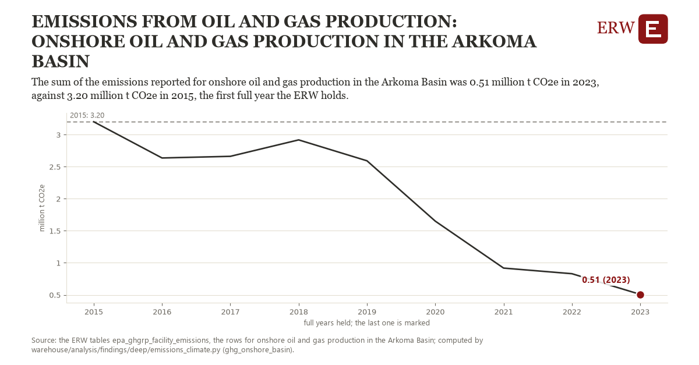

# Emissions from oil and gas production: onshore oil and gas production in the Arkoma Basin

Draft `scan-deep-8c7519b8ead3` of the findings hunt over the whole warehouse (chain 502), 2026-11-19. State: draft, not reviewed. Review at `/internal/findings`.

**The finding.** The sum of the emissions reported for onshore oil and gas production in the Arkoma Basin was 0.51 million t CO2e in 2023, against 3.20 million t CO2e in 2015, the first full year the ERW holds.

**The figure by full year** (million t CO2e): 2015: 3.20, 2016: 2.64, 2017: 2.66, 2018: 2.92, 2019: 2.59, 2020: 1.65, 2021: 0.92, 2022: 0.83, 2023: 0.51.

**The tables and rows.** `epa_ghgrp_facility_emissions`; the rows for onshore oil and gas production in the Arkoma Basin, region key `ghgon_345` (the card's `hunt.region`), years 2015 to 2023. The yearly values: `ghg-onshore-basin-ghgon-345.csv`.

**Its strength.** The change is 5.60 typical yearly moves (a typical move is 0.48 million t CO2e, 1.4826 times the median absolute change between full years). Holds in more than one year: 8 of the 8 full years after 2015 lie below 2015's value. Survives a change of window: from 2016 to 2023 the change is -2.13, from 2015 to 2022 it is -2.37. Sample large enough: 2015 holds 1 and 2023 holds 1 observations; the floor is 1. Half the change remains without the first year: from 2016 to 2023 the change is -2.13, 79.0 percent of the change from 2015. At least one typical yearly move: the change is 5.60 typical yearly moves (0.48 million t CO2e a year, the median move between full years); the floor is 1.

**Its limits.** EPA's Greenhouse Gas Reporting Program as the facilities reported it (facilities above its 25,000 t threshold); a facility that drops below it leaves the sum. The basin is the American Association of Petroleum Geologists' province.

**Reproduce.** `python ghg-onshore-basin-ghgon-345.reproduce.py <the table's CSV>` and `do ghg-onshore-basin-ghgon-345.reproduce.do` (Stata) recompute the figures by year from the tables as the public downloads hold them; each names the expected values at its top.
