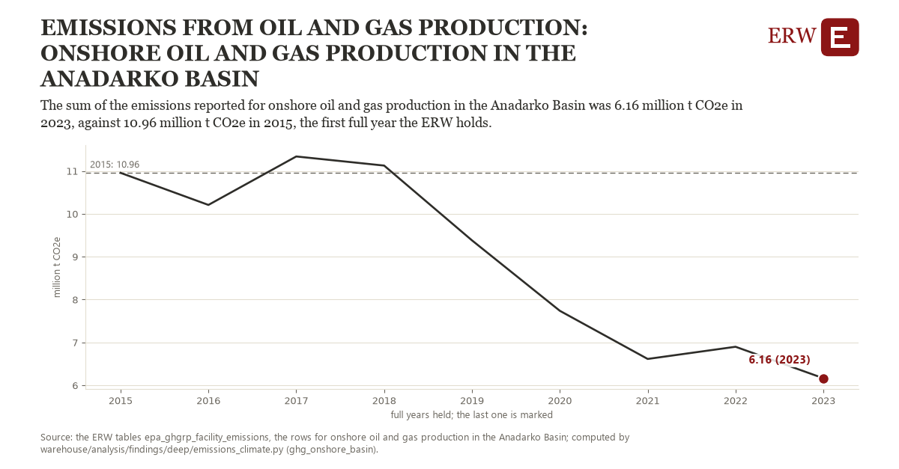

# Emissions from oil and gas production: onshore oil and gas production in the Anadarko Basin

Draft `scan-deep-147e03c2b391` of the findings hunt over the whole warehouse (chain 502), 2026-11-19. State: draft, not reviewed. Review at `/internal/findings`.

**The finding.** The sum of the emissions reported for onshore oil and gas production in the Anadarko Basin was 6.16 million t CO2e in 2023, against 10.96 million t CO2e in 2015, the first full year the ERW holds.

**The figure by full year** (million t CO2e): 2015: 10.96, 2016: 10.21, 2017: 11.34, 2018: 11.13, 2019: 9.38, 2020: 7.74, 2021: 6.61, 2022: 6.90, 2023: 6.16.

**The tables and rows.** `epa_ghgrp_facility_emissions`; the rows for onshore oil and gas production in the Anadarko Basin, region key `ghgon_360` (the card's `hunt.region`), years 2015 to 2023. The yearly values: `ghg-onshore-basin-ghgon-360.csv`.

**Its strength.** The change is 3.45 typical yearly moves (a typical move is 1.39 million t CO2e, 1.4826 times the median absolute change between full years). Holds in more than one year: 6 of the 8 full years after 2015 lie below 2015's value. Survives a change of window: from 2016 to 2023 the change is -4.04, from 2015 to 2022 it is -4.06. Sample large enough: 2015 holds 1 and 2023 holds 1 observations; the floor is 1. Half the change remains without the first year: from 2016 to 2023 the change is -4.04, 84.4 percent of the change from 2015. At least one typical yearly move: the change is 3.45 typical yearly moves (1.39 million t CO2e a year, the median move between full years); the floor is 1.

**Its limits.** EPA's Greenhouse Gas Reporting Program as the facilities reported it (facilities above its 25,000 t threshold); a facility that drops below it leaves the sum. The basin is the American Association of Petroleum Geologists' province.

**Reproduce.** `python ghg-onshore-basin-ghgon-360.reproduce.py <the table's CSV>` and `do ghg-onshore-basin-ghgon-360.reproduce.do` (Stata) recompute the figures by year from the tables as the public downloads hold them; each names the expected values at its top.
