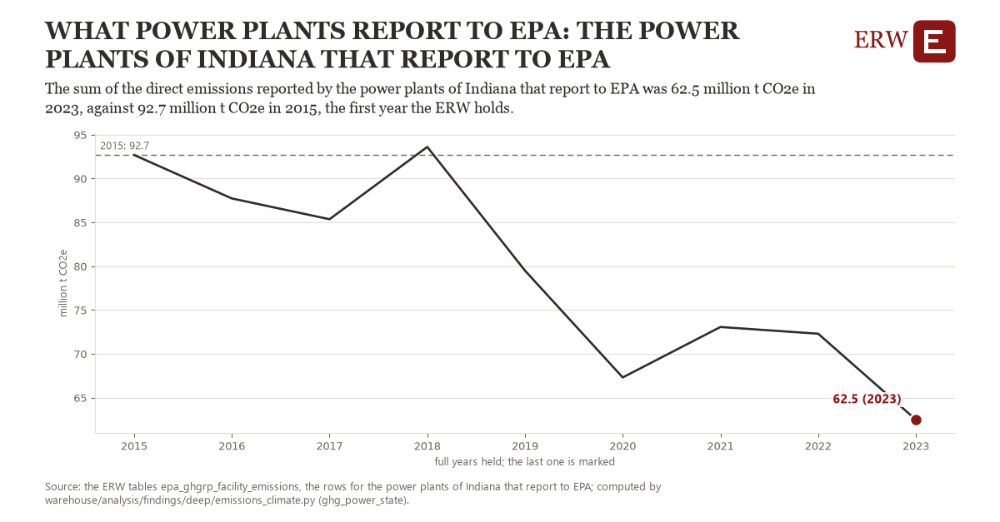

# What power plants report to epa: the power plants of Indiana that report to EPA

Draft `scan-deep-bfb3c3ca9ba1` of the findings hunt over the whole warehouse (chain 502), 2026-11-19. State: draft, not reviewed. Review at `/internal/findings`.

**The finding.** The sum of the direct emissions reported by the power plants of Indiana that report to EPA was 62.5 million t CO2e in 2023, against 92.7 million t CO2e in 2015, the first year the ERW holds.

**The figure by full year** (million t CO2e): 2015: 92.7, 2016: 87.7, 2017: 85.4, 2018: 93.6, 2019: 79.5, 2020: 67.3, 2021: 73.1, 2022: 72.3, 2023: 62.5.

**The tables and rows.** `epa_ghgrp_facility_emissions`; the rows for the power plants of Indiana that report to EPA, region key `ghgpp_in` (the card's `hunt.region`), years 2015 to 2023. The yearly values: `ghg-power-state-ghgpp-in.csv`.

**Its strength.** The change is 2.91 typical yearly moves (a typical move is 10.4 million t CO2e, 1.4826 times the median absolute change between full years). Holds in more than one year: 7 of the 8 full years after 2015 lie below 2015's value. Survives a change of window: from 2016 to 2023 the change is -25.2, from 2015 to 2022 it is -20.4. Sample large enough: 2015 holds 1 and 2023 holds 1 observations; the floor is 1. Half the change remains without the first year: from 2016 to 2023 the change is -25.2, 83.6 percent of the change from 2015. At least one typical yearly move: the change is 2.91 typical yearly moves (10.4 million t CO2e a year, the median move between full years); the floor is 1.

**Its limits.** EPA's Greenhouse Gas Reporting Program as the facilities reported it (facilities above its 25,000 t threshold); a facility that drops below it leaves the sum.

**Reproduce.** `python ghg-power-state-ghgpp-in.reproduce.py <the table's CSV>` and `do ghg-power-state-ghgpp-in.reproduce.do` (Stata) recompute the figures by year from the tables as the public downloads hold them; each names the expected values at its top.
