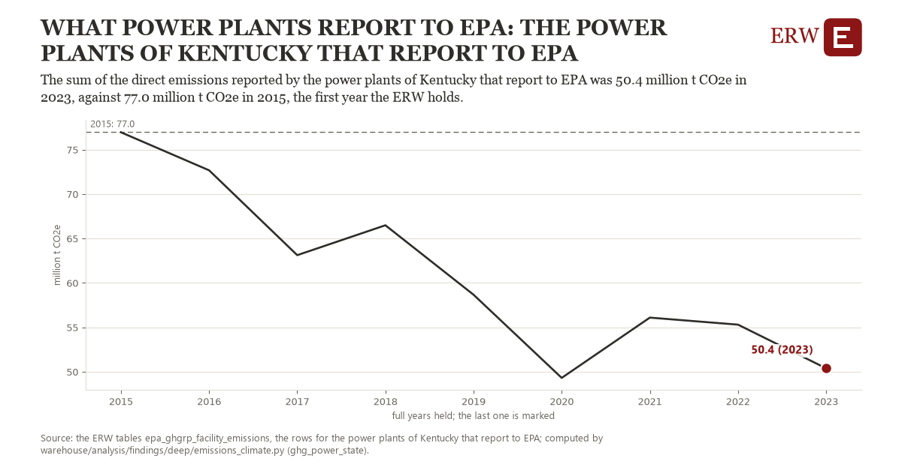

# What power plants report to epa: the power plants of Kentucky that report to EPA

Draft `scan-deep-b7ed08748e5b` of the findings hunt over the whole warehouse (chain 502), 2026-11-19. State: draft, not reviewed. Review at `/internal/findings`.

**The finding.** The sum of the direct emissions reported by the power plants of Kentucky that report to EPA was 50.4 million t CO2e in 2023, against 77.0 million t CO2e in 2015, the first year the ERW holds.

**The figure by full year** (million t CO2e): 2015: 77.0, 2016: 72.7, 2017: 63.1, 2018: 66.5, 2019: 58.7, 2020: 49.3, 2021: 56.1, 2022: 55.3, 2023: 50.4.

**The tables and rows.** `epa_ghgrp_facility_emissions`; the rows for the power plants of Kentucky that report to EPA, region key `ghgpp_ky` (the card's `hunt.region`), years 2015 to 2023. The yearly values: `ghg-power-state-ghgpp-ky.csv`.

**Its strength.** The change is 3.06 typical yearly moves (a typical move is 8.7 million t CO2e, 1.4826 times the median absolute change between full years). Holds in more than one year: 8 of the 8 full years after 2015 lie below 2015's value. Survives a change of window: from 2016 to 2023 the change is -22.3, from 2015 to 2022 it is -21.7. Sample large enough: 2015 holds 1 and 2023 holds 1 observations; the floor is 1. Half the change remains without the first year: from 2016 to 2023 the change is -22.3, 83.9 percent of the change from 2015. At least one typical yearly move: the change is 3.06 typical yearly moves (8.7 million t CO2e a year, the median move between full years); the floor is 1.

**Its limits.** EPA's Greenhouse Gas Reporting Program as the facilities reported it (facilities above its 25,000 t threshold); a facility that drops below it leaves the sum.

**Reproduce.** `python ghg-power-state-ghgpp-ky.reproduce.py <the table's CSV>` and `do ghg-power-state-ghgpp-ky.reproduce.do` (Stata) recompute the figures by year from the tables as the public downloads hold them; each names the expected values at its top.
