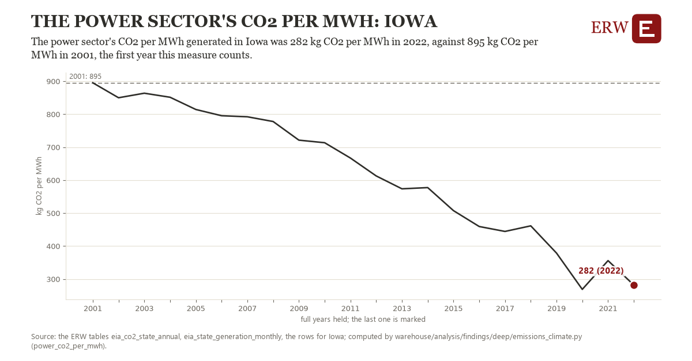

# The power sector's co2 per mwh: Iowa

Draft `scan-deep-cd77164267f1` of the findings hunt over the whole warehouse (chain 164), 2026-11-06. State: draft, not reviewed. Review at `/internal/findings`.

**The finding.** The power sector's CO2 per MWh generated in Iowa was 282 kg CO2 per MWh in 2022, against 895 kg CO2 per MWh in 2001, the first year this measure counts.

**The figure by full year** (kg CO2 per MWh): 2001: 895, 2002: 850, 2003: 864, 2004: 851, 2005: 814, 2006: 795, 2007: 792, 2008: 778, 2009: 721, 2010: 713, 2011: 667, 2012: 613, 2013: 574, 2014: 577, 2015: 507, 2016: 459, 2017: 444, 2018: 461, 2019: 379, 2020: 269, 2021: 356, 2022: 282.

**The tables and rows.** `eia_co2_state_annual`, `eia_state_generation_monthly`; the rows for Iowa, region key `co2mwh_IA` (the card's `hunt.region`), years 2001 to 2022. The yearly values: `power-co2-per-mwh-co2mwh-ia.csv`.

**Its strength.** The change is 10.58 typical yearly moves (a typical move is 58 kg CO2 per MWh, 1.4826 times the median absolute change between full years). Holds in more than one year: 21 of the 21 full years after 2001 lie below 2001's value. Survives a change of window: from 2002 to 2022 the change is -568, from 2001 to 2021 it is -539. Sample large enough: 2001 holds 1 and 2022 holds 1 observations; the floor is 1. Half the change remains without the first year: from 2002 to 2022 the change is -568, 92.6 percent of the change from 2001. At least one typical yearly move: the change is 10.58 typical yearly moves (58 kg CO2 per MWh a year, the median move between full years); the floor is 1.

**Its limits.** EIA's energy-related CO2 by state, which ends in 2022 in the ERW's table; it counts fuel burned, not the electricity a state imports. Two families in one figure: EIA's CO2 by state over its net generation; combined heat and power plants' heat is in the CO2 and not in the MWh.

**Reproduce.** `python power-co2-per-mwh-co2mwh-ia.reproduce.py <the table's CSV>` and `do power-co2-per-mwh-co2mwh-ia.reproduce.do` (Stata) recompute the figures by year from the tables as the public downloads hold them; each names the expected values at its top.
