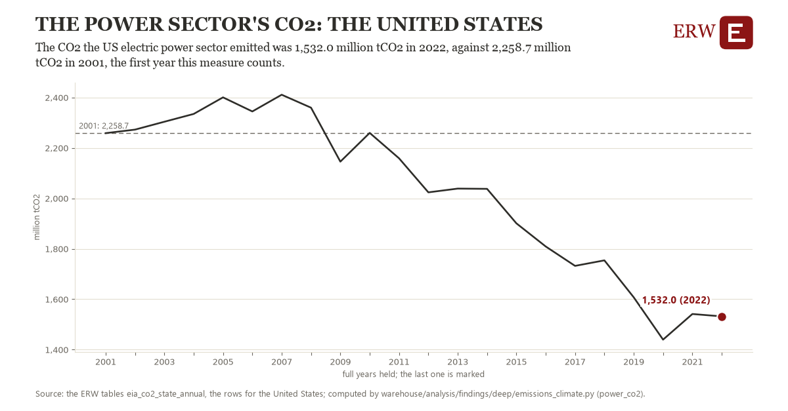

# The power sector's co2: the United States

Draft `scan-deep-13f51f12c4f5` of the findings hunt over the whole warehouse (chain 164), 2026-11-06. State: draft, not reviewed. Review at `/internal/findings`.

**The finding.** The CO2 the US electric power sector emitted was 1,532.0 million tCO2 in 2022, against 2,258.7 million tCO2 in 2001, the first year this measure counts.

**The figure by full year** (million tCO2): 2001: 2,258.7, 2002: 2,272.7, 2003: 2,303.9, 2004: 2,334.8, 2005: 2,400.5, 2006: 2,344.7, 2007: 2,411.0, 2008: 2,359.7, 2009: 2,145.7, 2010: 2,259.6, 2011: 2,158.9, 2012: 2,023.9, 2013: 2,038.8, 2014: 2,037.8, 2015: 1,901.0, 2016: 1,809.2, 2017: 1,732.3, 2018: 1,754.2, 2019: 1,607.6, 2020: 1,439.8, 2021: 1,541.4, 2022: 1,532.0.

**The tables and rows.** `eia_co2_state_annual`; the rows for the United States, region key `us_power_co2` (the card's `hunt.region`), years 2001 to 2022. The yearly values: `power-co2-us-power-co2.csv`.

**Its strength.** The change is 7.40 typical yearly moves (a typical move is 98.2 million tCO2, 1.4826 times the median absolute change between full years). Holds in more than one year: 13 of the 21 full years after 2001 lie below 2001's value. Survives a change of window: from 2002 to 2022 the change is -740.6, from 2001 to 2021 it is -717.2. Sample large enough: 2001 holds 1 and 2022 holds 1 observations; the floor is 1. Half the change remains without the first year: from 2002 to 2022 the change is -740.6, 101.9 percent of the change from 2001. At least one typical yearly move: the change is 7.40 typical yearly moves (98.2 million tCO2 a year, the median move between full years); the floor is 1.

**Its limits.** EIA's energy-related CO2 by state, which ends in 2022 in the ERW's table; it counts fuel burned, not the electricity a state imports.

**Reproduce.** `python power-co2-us-power-co2.reproduce.py <the table's CSV>` and `do power-co2-us-power-co2.reproduce.do` (Stata) recompute the figures by year from the tables as the public downloads hold them; each names the expected values at its top.
