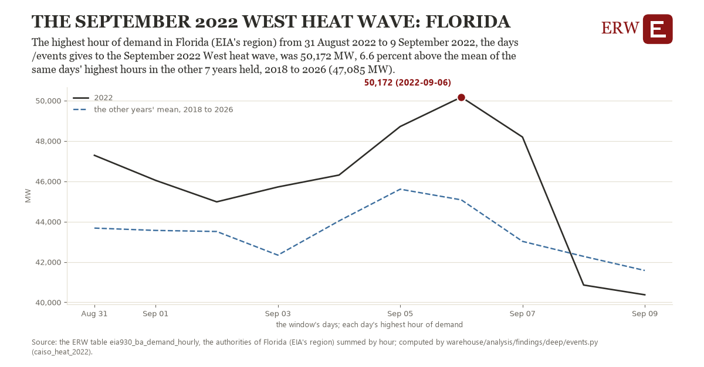

# The september 2022 west heat wave: Florida (EIA's region)

Draft `scan-deep-8810578c6175` of the findings hunt (chain 502), 2026-11-19. State: draft, not reviewed. Review at `/internal/findings`.

**The finding.** The highest hour of demand in Florida (EIA's region) from 31 August 2022 to 9 September 2022, the days /events gives to the September 2022 West heat wave, was 50,172 MW, 6.6 percent above the mean of the same days' highest hours in the other 7 years held, 2018 to 2026 (47,085 MW).

**The figure by year** (the window's highest hour of demand, MW): 2018: 44,347, 2020: 48,834, 2021: 45,640, 2022: 50,172, 2023: 48,726, 2024: 47,232, 2025: 47,273, 2026: 47,544.

**The tables and rows.** `eia930_ba_demand_hourly`; the authorities of Florida (EIA's region) summed by hour, the hours from 08-31 to 09-09 of each year. The yearly values: `caiso-heat-2022-fla.csv`.

**Its strength.** The gap is 1.43 typical spreads of the other years. The extreme of the years held: 2022's figure is 50,172 MW; the highest other year's is 48,834 MW. Clear by a typical spread: the distance from the other years' mean is 3,087 MW against a typical spread of 2,154 MW. Sample large enough: 7 other years each hold at least 90 percent of the window's hours; 2022 holds 240 of 240. Holds against the median: the distance from the other years' median is 2,899 MW. Not one hour: the window's third-highest hour is 98.4 percent of its highest.

**Its limits.** EIA-930 demand as the authorities filed it, summed by region (an hour held only when every authority filing demand that month holds it); demand served during a load shed is load served, a floor on what was wanted; the same calendar days in UTC of the other years, not the weekday-aligned baseline of the /events pages.

**Reproduce.** `python caiso-heat-2022-fla.reproduce.py <eia930_ba_demand_hourly.csv>` and `do caiso-heat-2022-fla.reproduce.do` (Stata) recompute every year's figure; each names the expected values at its top, and the claim's mean of the other years.
