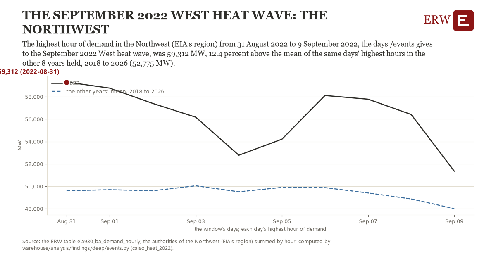

# The september 2022 west heat wave: the Northwest (EIA's region)

Draft `scan-deep-bdfa79de7a36` of the findings hunt (chain 502), 2026-11-19. State: draft, not reviewed. Review at `/internal/findings`.

**The finding.** The highest hour of demand in the Northwest (EIA's region) from 31 August 2022 to 9 September 2022, the days /events gives to the September 2022 West heat wave, was 59,312 MW, 12.4 percent above the mean of the same days' highest hours in the other 8 years held, 2018 to 2026 (52,775 MW).

**The figure by year** (the window's highest hour of demand, MW): 2018: 45,178, 2019: 54,290, 2020: 50,195, 2021: 53,092, 2022: 59,312, 2023: 53,128, 2024: 56,077, 2025: 56,409, 2026: 53,828.

**The tables and rows.** `eia930_ba_demand_hourly`; the authorities of the Northwest (EIA's region) summed by hour, the hours from 08-31 to 09-09 of each year. The yearly values: `caiso-heat-2022-nw.csv`.

**Its strength.** The gap is 2.59 typical spreads of the other years. The extreme of the years held: 2022's figure is 59,312 MW; the highest other year's is 56,409 MW. Clear by a typical spread: the distance from the other years' mean is 6,537 MW against a typical spread of 2,529 MW. Sample large enough: 8 other years each hold at least 90 percent of the window's hours; 2022 holds 240 of 240. Holds against the median: the distance from the other years' median is 5,834 MW. Not one hour: the window's third-highest hour is 99.1 percent of its highest.

**Its limits.** EIA-930 demand as the authorities filed it, summed by region (an hour held only when every authority filing demand that month holds it); demand served during a load shed is load served, a floor on what was wanted; the same calendar days in UTC of the other years, not the weekday-aligned baseline of the /events pages.

**Reproduce.** `python caiso-heat-2022-nw.reproduce.py <eia930_ba_demand_hourly.csv>` and `do caiso-heat-2022-nw.reproduce.do` (Stata) recompute every year's figure; each names the expected values at its top, and the claim's mean of the other years.
