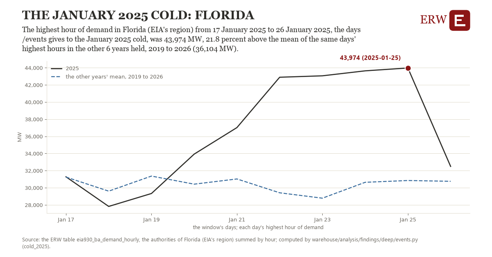

# The january 2025 cold: Florida (EIA's region)

Draft `scan-deep-18a4dcd0ad9f` of the findings hunt (chain 502), 2026-11-19. State: draft, not reviewed. Review at `/internal/findings`.

**The finding.** The highest hour of demand in Florida (EIA's region) from 17 January 2025 to 26 January 2025, the days /events gives to the January 2025 cold, was 43,974 MW, 21.8 percent above the mean of the same days' highest hours in the other 6 years held, 2019 to 2026 (36,104 MW).

**The figure by year** (the window's highest hour of demand, MW): 2019: 33,094, 2021: 33,092, 2022: 39,499, 2023: 34,720, 2024: 37,034, 2025: 43,974, 2026: 39,182.

**The tables and rows.** `eia930_ba_demand_hourly`; the authorities of Florida (EIA's region) summed by hour, the hours from 01-17 to 01-26 of each year. The yearly values: `cold-2025-fla.csv`.

**Its strength.** The gap is 1.91 typical spreads of the other years. The extreme of the years held: 2025's figure is 43,974 MW; the highest other year's is 39,499 MW. Clear by a typical spread: the distance from the other years' mean is 7,870 MW against a typical spread of 4,128 MW. Sample large enough: 6 other years each hold at least 90 percent of the window's hours; 2025 holds 239 of 240. Holds against the median: the distance from the other years' median is 8,097 MW. Not one hour: the window's third-highest hour is 99.2 percent of its highest.

**Its limits.** EIA-930 demand as the authorities filed it, summed by region (an hour held only when every authority filing demand that month holds it); demand served during a load shed is load served, a floor on what was wanted; the same calendar days in UTC of the other years, not the weekday-aligned baseline of the /events pages.

**Reproduce.** `python cold-2025-fla.reproduce.py <eia930_ba_demand_hourly.csv>` and `do cold-2025-fla.reproduce.do` (Stata) recompute every year's figure; each names the expected values at its top, and the claim's mean of the other years.
