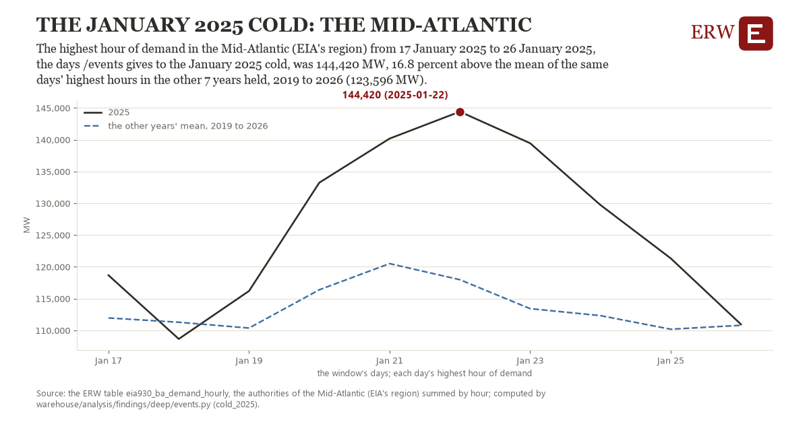

# The january 2025 cold: the Mid-Atlantic (EIA's region)

Draft `scan-deep-978aff242ee6` of the findings hunt (chain 502), 2026-11-19. State: draft, not reviewed. Review at `/internal/findings`.

**The finding.** The highest hour of demand in the Mid-Atlantic (EIA's region) from 17 January 2025 to 26 January 2025, the days /events gives to the January 2025 cold, was 144,420 MW, 16.8 percent above the mean of the same days' highest hours in the other 7 years held, 2019 to 2026 (123,596 MW).

**The figure by year** (the window's highest hour of demand, MW): 2019: 132,175, 2020: 120,097, 2021: 109,300, 2022: 125,073, 2023: 109,647, 2024: 133,949, 2025: 144,420, 2026: 134,928.

**The tables and rows.** `eia930_ba_demand_hourly`; the authorities of the Mid-Atlantic (EIA's region) summed by hour, the hours from 01-17 to 01-26 of each year. The yearly values: `cold-2025-mida.csv`.

**Its strength.** The gap is 1.58 typical spreads of the other years. The extreme of the years held: 2025's figure is 144,420 MW; the highest other year's is 134,928 MW. Clear by a typical spread: the distance from the other years' mean is 20,824 MW against a typical spread of 13,160 MW. Sample large enough: 7 other years each hold at least 90 percent of the window's hours; 2025 holds 240 of 240. Holds against the median: the distance from the other years' median is 19,347 MW. Not one hour: the window's third-highest hour is 98.2 percent of its highest.

**Its limits.** EIA-930 demand as the authorities filed it, summed by region (an hour held only when every authority filing demand that month holds it); demand served during a load shed is load served, a floor on what was wanted; the same calendar days in UTC of the other years, not the weekday-aligned baseline of the /events pages.

**Reproduce.** `python cold-2025-mida.reproduce.py <eia930_ba_demand_hourly.csv>` and `do cold-2025-mida.reproduce.do` (Stata) recompute every year's figure; each names the expected values at its top, and the claim's mean of the other years.
