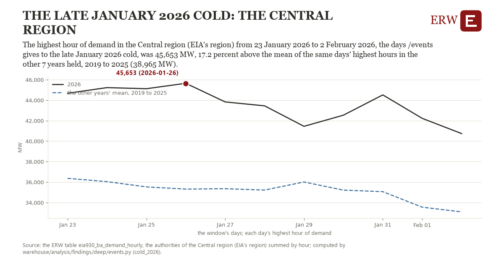

# The late january 2026 cold: the Central region (EIA's region)

Draft `scan-deep-743f21cefc73` of the findings hunt (chain 502), 2026-11-19. State: draft, not reviewed. Review at `/internal/findings`.

**The finding.** The highest hour of demand in the Central region (EIA's region) from 23 January 2026 to 2 February 2026, the days /events gives to the late January 2026 cold, was 45,653 MW, 17.2 percent above the mean of the same days' highest hours in the other 7 years held, 2019 to 2025 (38,965 MW).

**The figure by year** (the window's highest hour of demand, MW): 2019: 40,344, 2020: 35,049, 2021: 36,911, 2022: 39,196, 2023: 40,683, 2024: 37,307, 2025: 43,266, 2026: 45,653.

**The tables and rows.** `eia930_ba_demand_hourly`; the authorities of the Central region (EIA's region) summed by hour, the hours from 01-23 to 02-02 of each year. The yearly values: `cold-2026-cent.csv`.

**Its strength.** The gap is 2.39 typical spreads of the other years. The extreme of the years held: 2026's figure is 45,653 MW; the highest other year's is 43,266 MW. Clear by a typical spread: the distance from the other years' mean is 6,688 MW against a typical spread of 2,801 MW. Sample large enough: 7 other years each hold at least 90 percent of the window's hours; 2026 holds 264 of 264. Holds against the median: the distance from the other years' median is 6,457 MW. Not one hour: the window's third-highest hour is 99.1 percent of its highest.

**Its limits.** EIA-930 demand as the authorities filed it, summed by region (an hour held only when every authority filing demand that month holds it); demand served during a load shed is load served, a floor on what was wanted; the same calendar days in UTC of the other years, not the weekday-aligned baseline of the /events pages.

**Reproduce.** `python cold-2026-cent.reproduce.py <eia930_ba_demand_hourly.csv>` and `do cold-2026-cent.reproduce.do` (Stata) recompute every year's figure; each names the expected values at its top, and the claim's mean of the other years.
