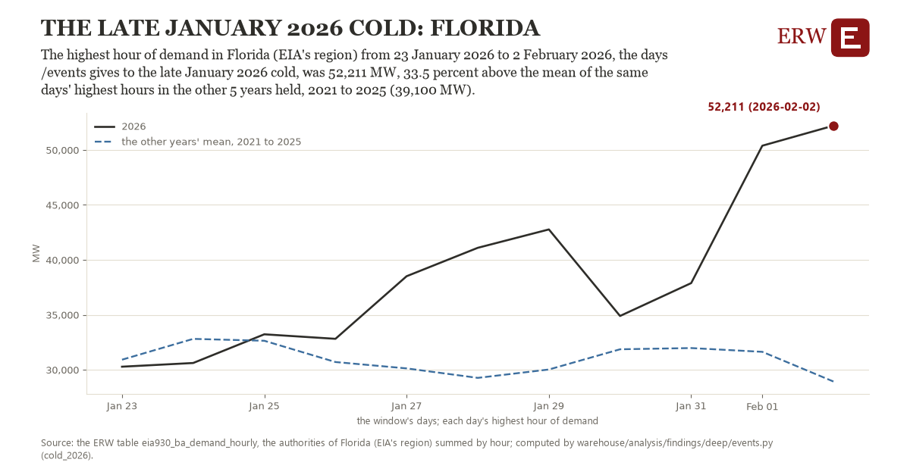

# The late january 2026 cold: Florida (EIA's region)

Draft `scan-deep-54120c3d5ea6` of the findings hunt (chain 502), 2026-11-19. State: draft, not reviewed. Review at `/internal/findings`.

**The finding.** The highest hour of demand in Florida (EIA's region) from 23 January 2026 to 2 February 2026, the days /events gives to the late January 2026 cold, was 52,211 MW, 33.5 percent above the mean of the same days' highest hours in the other 5 years held, 2021 to 2025 (39,100 MW).

**The figure by year** (the window's highest hour of demand, MW): 2021: 32,499, 2022: 42,266, 2023: 33,720, 2024: 43,040, 2025: 43,974, 2026: 52,211.

**The tables and rows.** `eia930_ba_demand_hourly`; the authorities of Florida (EIA's region) summed by hour, the hours from 01-23 to 02-02 of each year. The yearly values: `cold-2026-fla.csv`.

**Its strength.** The gap is 5.18 typical spreads of the other years. The extreme of the years held: 2026's figure is 52,211 MW; the highest other year's is 43,974 MW. Clear by a typical spread: the distance from the other years' mean is 13,111 MW against a typical spread of 2,532 MW. Sample large enough: 5 other years each hold at least 90 percent of the window's hours; 2026 holds 264 of 264. Holds against the median: the distance from the other years' median is 9,945 MW. Not one hour: the window's third-highest hour is 96.7 percent of its highest.

**Its limits.** EIA-930 demand as the authorities filed it, summed by region (an hour held only when every authority filing demand that month holds it); demand served during a load shed is load served, a floor on what was wanted; the same calendar days in UTC of the other years, not the weekday-aligned baseline of the /events pages.

**Reproduce.** `python cold-2026-fla.reproduce.py <eia930_ba_demand_hourly.csv>` and `do cold-2026-fla.reproduce.do` (Stata) recompute every year's figure; each names the expected values at its top, and the claim's mean of the other years.
