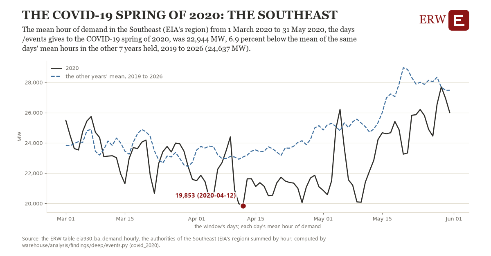

# The covid-19 spring of 2020: the Southeast (EIA's region)

Draft `scan-deep-f537cd623487` of the findings hunt (chain 502), 2026-11-19. State: draft, not reviewed. Review at `/internal/findings`.

**The finding.** The mean hour of demand in the Southeast (EIA's region) from 1 March 2020 to 31 May 2020, the days /events gives to the COVID-19 spring of 2020, was 22,944 MW, 6.9 percent below the mean of the same days' mean hours in the other 7 years held, 2019 to 2026 (24,637 MW).

**The figure by year** (the window's mean hour of demand, MW): 2019: 25,477, 2020: 22,944, 2021: 23,902, 2022: 25,355, 2023: 23,617, 2024: 24,321, 2025: 24,671, 2026: 25,119.

**The tables and rows.** `eia930_ba_demand_hourly`; the authorities of the Southeast (EIA's region) summed by hour, the hours from 03-01 to 05-31 of each year. The yearly values: `covid-2020-se.csv`.

**Its strength.** The gap is 1.67 typical spreads of the other years. The extreme of the years held: 2020's figure is 22,944 MW; the lowest other year's is 23,617 MW. Clear by a typical spread: the distance from the other years' mean is 1,694 MW against a typical spread of 1,015 MW. Sample large enough: 7 other years each hold at least 90 percent of the window's hours; 2020 holds 2208 of 2208. Holds against the median: the distance from the other years' median is 1,727 MW. Not one hour: a mean over the window's hours.

**Its limits.** EIA-930 demand as the authorities filed it, summed by region (an hour held only when every authority filing demand that month holds it); demand served during a load shed is load served, a floor on what was wanted; the same calendar days in UTC of the other years, not the weekday-aligned baseline of the /events pages.

**Reproduce.** `python covid-2020-se.reproduce.py <eia930_ba_demand_hourly.csv>` and `do covid-2020-se.reproduce.do` (Stata) recompute every year's figure; each names the expected values at its top, and the claim's mean of the other years.
