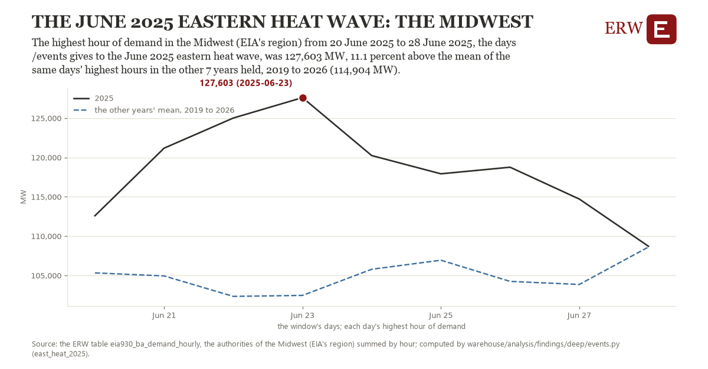

# The june 2025 eastern heat wave: the Midwest (EIA's region)

Draft `scan-deep-ce7614f638b8` of the findings hunt (chain 502), 2026-11-19. State: draft, not reviewed. Review at `/internal/findings`.

**The finding.** The highest hour of demand in the Midwest (EIA's region) from 20 June 2025 to 28 June 2025, the days /events gives to the June 2025 eastern heat wave, was 127,603 MW, 11.1 percent above the mean of the same days' highest hours in the other 7 years held, 2019 to 2026 (114,904 MW).

**The figure by year** (the window's highest hour of demand, MW): 2019: 113,477, 2020: 105,170, 2021: 111,388, 2022: 127,567, 2023: 113,366, 2024: 120,136, 2025: 127,603, 2026: 113,225.

**The tables and rows.** `eia930_ba_demand_hourly`; the authorities of the Midwest (EIA's region) summed by hour, the hours from 06-20 to 06-28 of each year. The yearly values: `east-heat-2025-midw.csv`.

**Its strength.** The gap is 4.33 typical spreads of the other years. The extreme of the years held: 2025's figure is 127,603 MW; the highest other year's is 127,567 MW. Clear by a typical spread: the distance from the other years' mean is 12,699 MW against a typical spread of 2,933 MW. Sample large enough: 7 other years each hold at least 90 percent of the window's hours; 2025 holds 216 of 216. Holds against the median: the distance from the other years' median is 14,237 MW. Not one hour: the window's third-highest hour is 99.6 percent of its highest.

**Its limits.** EIA-930 demand as the authorities filed it, summed by region (an hour held only when every authority filing demand that month holds it); demand served during a load shed is load served, a floor on what was wanted; the same calendar days in UTC of the other years, not the weekday-aligned baseline of the /events pages.

**Reproduce.** `python east-heat-2025-midw.reproduce.py <eia930_ba_demand_hourly.csv>` and `do east-heat-2025-midw.reproduce.do` (Stata) recompute every year's figure; each names the expected values at its top, and the claim's mean of the other years.
