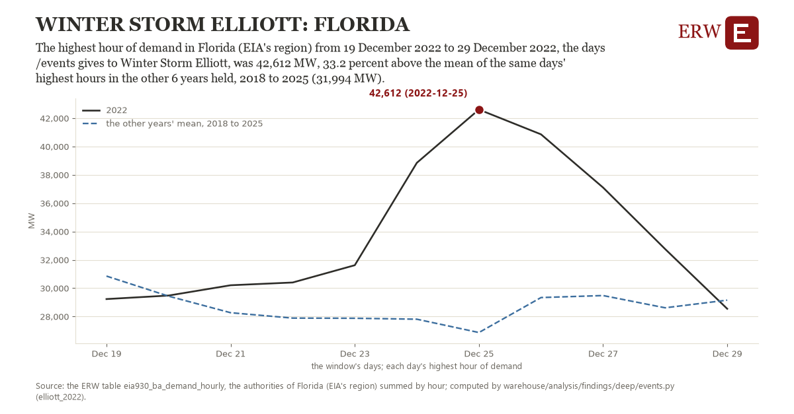

# Winter storm elliott: Florida (EIA's region)

Draft `scan-deep-da4082338af9` of the findings hunt (chain 502), 2026-11-19. State: draft, not reviewed. Review at `/internal/findings`.

**The finding.** The highest hour of demand in Florida (EIA's region) from 19 December 2022 to 29 December 2022, the days /events gives to Winter Storm Elliott, was 42,612 MW, 33.2 percent above the mean of the same days' highest hours in the other 6 years held, 2018 to 2025 (31,994 MW).

**The figure by year** (the window's highest hour of demand, MW): 2018: 30,329, 2020: 33,948, 2021: 32,454, 2022: 42,612, 2023: 30,242, 2024: 31,800, 2025: 33,188.

**The tables and rows.** `eia930_ba_demand_hourly`; the authorities of Florida (EIA's region) summed by hour, the hours from 12-19 to 12-29 of each year. The yearly values: `elliott-2022-fla.csv`.

**Its strength.** The gap is 5.01 typical spreads of the other years. The extreme of the years held: 2022's figure is 42,612 MW; the highest other year's is 33,948 MW. Clear by a typical spread: the distance from the other years' mean is 10,618 MW against a typical spread of 2,119 MW. Sample large enough: 6 other years each hold at least 90 percent of the window's hours; 2022 holds 263 of 264. Holds against the median: the distance from the other years' median is 10,485 MW. Not one hour: the window's third-highest hour is 97.3 percent of its highest.

**Its limits.** EIA-930 demand as the authorities filed it, summed by region (an hour held only when every authority filing demand that month holds it); demand served during a load shed is load served, a floor on what was wanted; the same calendar days in UTC of the other years, not the weekday-aligned baseline of the /events pages.

**Reproduce.** `python elliott-2022-fla.reproduce.py <eia930_ba_demand_hourly.csv>` and `do elliott-2022-fla.reproduce.do` (Stata) recompute every year's figure; each names the expected values at its top, and the claim's mean of the other years.
